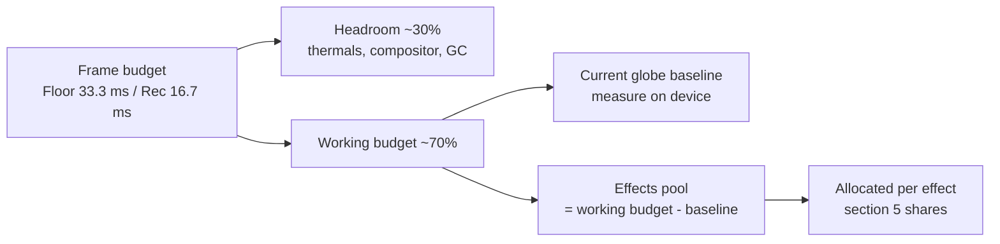
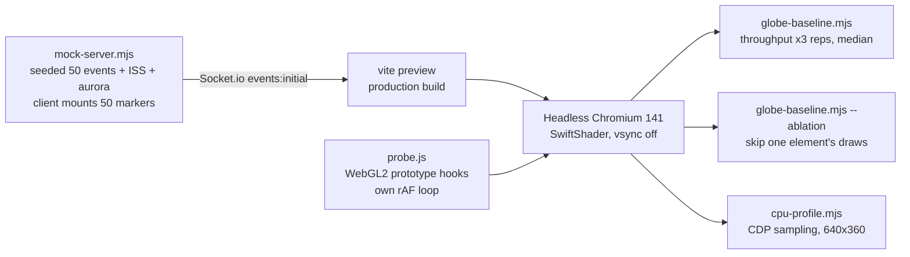
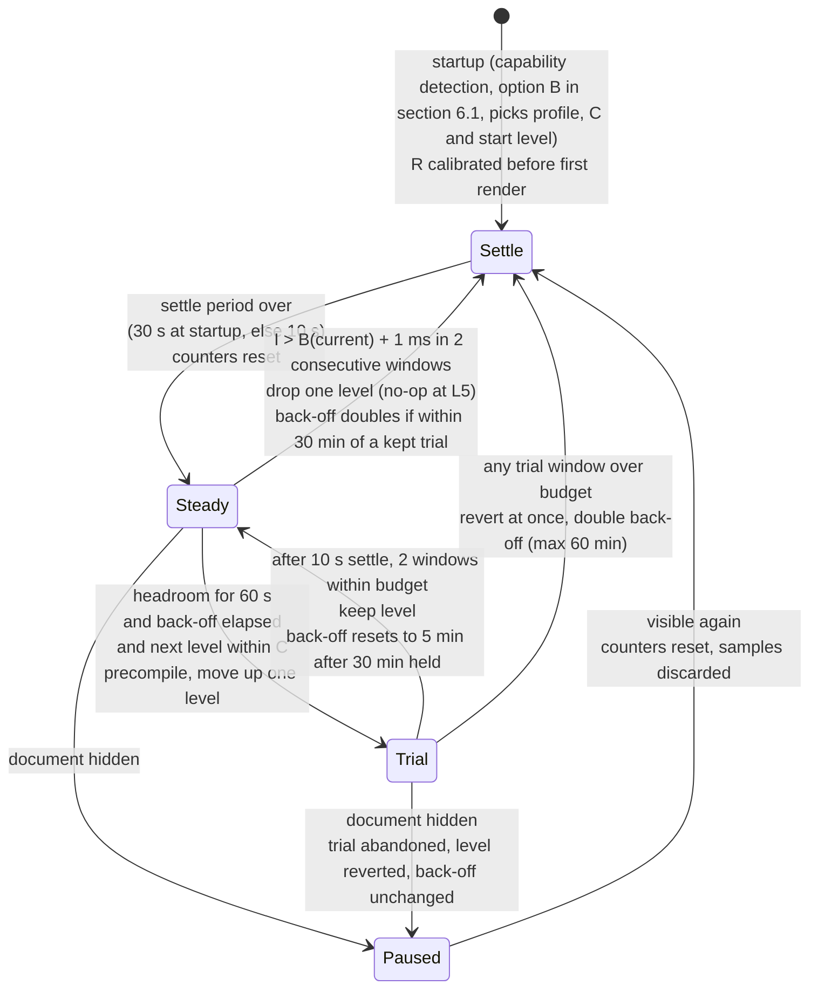

# Technical Specification: Display Targets and Frame Budget (Spike)

**Issue**: #384 (spike) | **Parent Feature**: #356 Performance and accessibility guardrails | **Epic**: #348 Living Globe
**Status**: Accepted (revision 3 merged in PR #438, `99fa237`), with a post-merge correction on 2026-10-19: the governor fixes from the "Re-review (revision 3, post-merge)" section of `docs/reviews/REVIEW-384.md` (B1, S1 to S6, the spec part of S9, O1 to O8) are applied to sections 3, 4.1, 6.2, 7, 8 and 10. Owner decisions of 2026-10-18 are in section 9; items 1 to 6 there are still open.
**Author**: Architect agent | **Date**: 2026-10-18 (correction 2026-10-19)
**Location note**: this lives at `docs/specs/SPEC-384.md`, matching the existing `docs/specs/SPEC-{issue}.md` naming. There is no `docs/performance/` folder, and this spike doesn't create one.
**Tooling**: `scripts/perf/` (probe, mock backend, runners, on-device procedure in `scripts/perf/README.md`). Nothing in `src/` was changed.

> **How to read the numbers.** Every number is labelled with how it was measured. Container numbers come from headless Chromium 141 using **SwiftShader software GL** on a 4-vCPU Intel Xeon 2.1 GHz VM. That makes them good for **relative** comparisons (element A vs B, 1080p vs 4K, 0 vs 50 markers) and for **exact counts** (draw calls, triangles, texture bytes). They are **not** an estimate of fps on any real display. Hardware targets below are **assumptions** until someone runs the on-device procedure.

---

## 1. Summary

| Question                         | Answer                                                                                                                                                                                                                                                                                                                                         |
| -------------------------------- | ---------------------------------------------------------------------------------------------------------------------------------------------------------------------------------------------------------------------------------------------------------------------------------------------------------------------------------------------- |
| Lowest supported display         | **Decided (owner, 2026-10-18):** Raspberry Pi 5 driving a 1080p TV. A different floor device may replace it if it needs fewer tradeoffs. Broad backwards compatibility is not required. Built-in smart-TV browsers are not a supported render host.                                                                                            |
| Frame budget                     | Floor tier: 30 fps (33.3 ms), p95 50 ms or less. Recommended and Showpiece tiers: 60 fps (16.7 ms), p95 20 ms or less.                                                                                                                                                                                                                         |
| What the current globe costs     | 265 draw calls, 42.6k triangles, 58.2 MiB of textures at 50 markers (exact). The marker system is **about 74% of draw calls** (196 of 265) and adds about **4 ms/frame of main-thread JS** on the container CPU. Fill cost is led by the earth sphere, then the atmosphere shells and the wireframe overlay. Device pixel ratio is not capped. |
| Effects that need a lite path    | Phosphor bloom, sweep and ping, pulse-ring expansion, and fire-marker animation and count. Terminator, callout and alert dim stay cheap if built as specified, so they need no lite variant (section 6).                                                                                                                                       |
| Prerequisites before new effects | Explicit DPR cap, instanced markers and rings, a quality profile with a frame-time governor, and a draw-call/texture regression check (section 8).                                                                                                                                                                                             |

---

## 2. Target hardware tiers (Floor choice decided 2026-10-18; device capabilities still unverified)

None of these devices was available to the spike. Device capabilities listed come from public specs and **have not been verified here**.

| Tier                        | Reference devices (assumed)                                                                                                                           | Runtime                                                                                             | Resolution and DPR cap                                                               | Default profile       |
| --------------------------- | ----------------------------------------------------------------------------------------------------------------------------------------------------- | --------------------------------------------------------------------------------------------------- | ------------------------------------------------------------------------------------ | --------------------- |
| **Floor** (minimum)         | Raspberry Pi 5 (4 GB or more, VideoCore VII, WebGL2 through Mesa) on a 1080p TV                                                                       | Chromium kiosk or Electron arm64                                                                    | 1920x1080, DPR cap **1.0**                                                           | Lite                  |
| **Recommended**             | Mini PC or laptop with Intel Iris Xe-class iGPU or Apple M1; iPad Air/Pro (M1 or newer)                                                               | Electron (primary) or desktop Chrome/Safari on the mini PC or laptop; Safari on iPadOS for the iPad | 1080p to 1440p, DPR cap **1.5**                                                      | Full (bloom half-res) |
| **Showpiece**               | 4K TV or monitor driven by Apple M1 Pro or newer, or a discrete GPU (GTX 1660-class or better)                                                        | Electron                                                                                            | 3840x2160, DPR cap **1.0** at 4K (do not let OS scaling 2x push render size past 4K) | Full                  |
| **Unsupported render host** | Smart-TV built-in browsers (Tizen, webOS, Android TV WebView), Raspberry Pi 4 and older, iPad 9th gen and older (best effort, not a floor commitment) | Best effort only                                                                                    | Lite forced                                                                          | Lite                  |

"Unsupported" doesn't mean blocked. It means nobody commits to a budget for those devices. A TV is still supported as a **display**, driven over HDMI by a Floor-or-better device.

---

## 3. Frame-rate and frame-time budget per tier

CPU (main thread) and GPU work overlap, so each gets its own budget. About 30% of every frame is held back as headroom for thermals (always-on, often fanless), browser compositing and GC.

| Tier        | Target fps | Frame time | p95 frame     | Frames over 66 ms      | Main-thread JS per frame | GPU per frame | Texture memory cap | DPR cap |
| ----------- | ---------- | ---------- | ------------- | ---------------------- | ------------------------ | ------------- | ------------------ | ------- |
| Floor       | 30         | 33.3 ms    | 50 ms or less | 1% or less over 10 min | 16 ms or less            | 23 ms or less | 64 MiB             | 1.0     |
| Recommended | 60         | 16.7 ms    | 20 ms or less | 0.1% or less           | 8 ms or less             | 11 ms or less | 96 MiB             | 1.5     |
| Showpiece   | 60         | 16.7 ms    | 20 ms or less | 0.1% or less           | 8 ms or less             | 11 ms or less | 128 MiB            | 1.0 @4K |

Column to probe field mapping (`scripts/perf/probe.js`, `__wpPerf.stop().summary`). All frame metrics count **application rendered frames**: a browser `requestAnimationFrame` tick counts as a rendered frame only if the app issued at least one draw call since the previous tick (`renderedFrames`, `fpsMean`, `frameMs*`, `framesOver*`, and every per-frame draw-call and triangle count). Browser cadence is reported separately (`rafTicks`, `rafFpsMean`, `rafIntervalMsP50`, `rafIntervalMsP95`), so a 30 fps cap on a 60 Hz display reads as about 30 rendered fps against about 60 rAF fps. Today the globe uses r3f's default `frameloop="always"` (`Globe.tsx`, `<Canvas>` without a `frameloop` prop), so the two are equal; they diverge once the L5 cap (section 6.2) or on-demand rendering exists. p95 frame is `frameMsP95`; frames over 66 ms is `pctFramesOver66ms` (count in `framesOver66ms`); main-thread JS is `rafCallbackMsP95`. `rafCallbackMsP95` is measured per rAF callback, not per frame; that equals per frame today because the app has one render loop (r3f) and no other `requestAnimationFrame` users in `src/`, and it must be re-checked if another rAF user is added. The probe also reports `framesOver33ms` and `framesOver50ms`; these are informative only (at a 30 fps Floor almost every frame is about 33.3 ms, so frames over 33 ms is not a budget metric).

**Timestamp tolerance.** Budget comparisons allow 1 ms for timestamp jitter: a p95 of 50.9 ms meets a 50 ms budget, and 51.1 ms misses it. This matters because 50 ms is exactly three ticks at 60 Hz, so at a 30 fps Floor or under the L5 cap every once-slipped frame lands on 50.0 ms plus or minus jitter; without a tolerance the "p95 50 ms or less" check would pass or fail at random. The governor uses the same rule (`I > B + 1 ms` is over budget, section 6.2). The probe's `framesOver*` counters apply the same 1 ms tolerance; that probe change is owned by the parallel `scripts/perf/` fix for this review, not by this spec. GPU per frame has no probe field: it needs `EXT_disjoint_timer_query_webgl2` or a platform GPU profiler on the device (section 4.5). Texture memory is the probe's `textureUploadMiB` (cumulative allocations; see AC 6).

Budget split for one frame:

**Hardware-independent ceilings.** These are exact, measurable in CI with `scripts/perf/probe.js` against the mock backend at 50 markers, and they hold on every tier:

| Metric                                          | Today (measured)             | Ceiling with all default-on effects (Full)                          | Ceiling (Lite)                              |
| ----------------------------------------------- | ---------------------------- | ------------------------------------------------------------------- | ------------------------------------------- |
| Draw calls per frame                            | 265                          | 300 (effects add 35 or fewer in total); 120 after marker instancing | 80 (only reachable after marker instancing) |
| Triangles per frame                             | 42,552                       | 100,000                                                             | 60,000                                      |
| Distinct shader programs (startup compile cost) | 10 (probe `programsCreated`) | 16                                                                  | 12                                          |
| Texture allocations incl. mipmaps               | 58.2 MiB                     | 96 MiB                                                              | 64 MiB                                      |
| Full-screen post-processing passes              | 0                            | 4 (bloom at half res)                                               | 0                                           |
| Per-frame React state updates from `useFrame`   | 1 (`CityLabelsWithTracking`) | 0 new                                                               | 0 new                                       |

---

## 4. Measurement method, results and limitations

### 4.1 Method

- The **probe** tags each WebGL program by its shader source (custom-shader uniforms, three.js `SHADER_TYPE` defines) and splits `MeshBasicMaterial` by geometry signature. It counts draw calls and primitives, records `texStorage2D` allocations, times rAF callbacks, and measures intervals between rendered frames and between rAF ticks separately (section 3). Per-element counts are accumulated inside completed frame records only, so they sum exactly to the per-frame total. It also reports the unmasked WebGL renderer string and the shader program count. The app itself isn't instrumented.
- **Throughput** runs: 4 s warm-up, then 10 s sampled, uncapped. Each runs 3 times interleaved and the median is reported. Mean frame time is 1000 / median fps.
- The `gl.finish()` attribution scenarios run only with `--attribution` (section 4.5 explains why their output is excluded). Without them, `globe-baseline.mjs --quick` completed in 248 s in the container (6 scenarios, 1 rep).
- **Ablation** skips one element's draw calls. That removes its raster and submission cost but not its CPU scene-graph cost.
- **CPU profile** runs at 640x360 so software fill doesn't stall the main thread, then buckets self time by bundle chunk. The `--startup` variant reports totals over the profiler's elapsed time, not per-frame rates.
- **Measured source revision.** The exact counts in section 4.2 describe `src/` as of `7dbd9d5` (the last commit that touched `src/`) built with three 0.186.1 (`903d71c`). They were measured on a `vite build` of pre-squash branch commit `12bec81`; the citable revision is `99fa237` on `main` (the PR #438 merge), whose `src/` is identical (`git diff --quiet 7dbd9d5 99fa237 -- src` exits 0) and whose fresh `vite build` reproduces the section 4.2 bundle sizes exactly (post-merge review).

### 4.2 Results: exact scene counts (hardware-independent)

| Item                         | Value                                                                                                                                                                                                                          | Source               |
| ---------------------------- | ------------------------------------------------------------------------------------------------------------------------------------------------------------------------------------------------------------------------------ | -------------------- |
| Draw calls/frame, 50 markers | 265 = markers 196 + labels 58 + earth 1, wireframe 1, graticule 1, atmosphere 2, stars 1, city lights 1, aurora 2, ISS 2. Markers: 50 mounted (cap) = 50 spheres + 50 x 2 ring passes + 23 x 2 pulse-ring passes (section 4.4) | probe per-tag count  |
| Draw calls/frame, 0 markers  | 77 (includes 8 marker draws for the ISS and aurora events, which also get event markers)                                                                                                                                       | probe                |
| Triangles/frame              | 42,552 (markers ~20.2k, earth ~9.3k, atmosphere ~8.2k, aurora ~4.7k, ISS ~0.8k). Line vertices: 15,424 (wireframe sphere, graticule). Points: 858                                                                              | probe                |
| Texture memory               | 58.2 MiB: earth map 4096x2048 with 13 mip levels (~42.7 MiB), normal map 2048x1024 (~10.7 MiB), 58 label sprite textures 256x64 (~85 KiB each; one per city, 58 cities in `cityData.ts`)                                       | probe `texStorage2D` |
| JS heap                      | 14.8 to 15.8 MiB after load                                                                                                                                                                                                    | `performance.memory` |
| Bundle                       | vendor-three 1,168.6 kB (324.3 kB gzip), main 601.4 kB (136.1 kB gzip), CSS 44.8 kB (9.3 kB gzip)                                                                                                                              | `vite build` output  |

### 4.3 Results: relative costs (SwiftShader, container; do not read as device fps)

Throughput, 1080p, median of 3:

| Scenario                         | fps (range)      | Mean frame ms | vs baseline   |
| -------------------------------- | ---------------- | ------------- | ------------- |
| Clear only (all draws skipped)   | 49.2 (46.7–49.4) | 20            | floor of page |
| Empty globe (0 markers)          | 8.4 (4.4–8.5)    | 119           | noisy         |
| **Baseline (50 markers), DPR 1** | 3.3 (3.2–3.5)    | 303           | 1.0x          |
| Baseline, DPR 2                  | 1.5 (1.4–1.6)    | 667           | 2.2x slower   |
| Baseline, 4K DPR 1               | 1.4 (1.4–1.6)    | 714           | 2.4x slower   |
| Baseline, reduced motion         | 4.0 (3.9–5.4)    | 250           | within noise  |

Ablation, 1080p, DPR 1, 50 markers, median of 3:

| Element skipped                                    | Frame ms | Saved vs 303 ms | Share |
| -------------------------------------------------- | -------- | --------------- | ----- |
| Earth sphere (`MeshStandardMaterial` + normal map) | 208      | 95              | ~31%  |
| Atmosphere (2 additive back-face shells)           | 250      | 53              | ~17%  |
| Wireframe overlay sphere                           | 250      | 53              | ~17%  |
| Markers (50 spheres, 50 rings, 23 pulse rings)     | 263      | 40              | ~13%  |
| City labels (58 sprites)                           | 286      | 17              | ~6%   |
| Stars                                              | 313      | 0 (noise)       | ~0%   |

Main-thread CPU (CDP sampling profile, 640x360, 10 s):

| Metric                                   | 0 markers | 50 markers |
| ---------------------------------------- | --------- | ---------- |
| rAF callback mean / p95 (ms)             | 1.7 / 3.5 | 5.8 / 10.8 |
| Non-idle main-thread ms per frame        | ~3.0      | ~8.3       |
| three.js + r3f chunk self time per frame | 1.0       | 3.5        |
| React + app chunk self time per frame    | 0.02      | 0.09       |

Startup (CDP profile from navigation to first draw):

| Metric                     | Value                                                                                                                                                                                      |
| -------------------------- | ------------------------------------------------------------------------------------------------------------------------------------------------------------------------------------------ |
| First WebGL draw after nav | 6.5 to 7.0 s                                                                                                                                                                               |
| Long tasks                 | ~1.4 to 1.6 s, then ~5.8 to 6.1 s                                                                                                                                                          |
| Attribution                | ~6.1 s in three.js program link-status check, a synchronous wait on shader compile. Its size is specific to SwiftShader. Another ~1.1 s goes to `generateHeightCanvas` (app JS, CPU-bound) |

### 4.4 Findings for the existing scene

1. **The marker system drives draw calls and main-thread cost.** In `src/renderer/components/Globe/Globe.tsx`, `EventMarkers` sorts located events (featured first, then severity, then recency), drops any within 5 degrees of an already kept marker (`deduplicateNearbyEvents`) and stops at `MAX_MARKERS = 50`. It renders `EventMarker`, `EventRing` and `EventPulseRing` only for that selection. That is two or three meshes per mounted marker: the pulse-ring mesh renders only at severity 5 or more or when featured, but all three `useFrame` callbacks are registered for every mounted marker, because `EventPulseRing` calls `useFrame` before its early return. Both rings are transparent and `THREE.DoubleSide`, so three.js draws each one twice (back faces, then front faces). The mock sends 52 located events (50 synthetic plus ISS and aurora). None is dropped by the 5-degree rule; the 50-marker cap drops the two lowest-severity events (`perf-10` at 0.1 and `perf-41` at 0), so 50 markers mount, ISS and aurora included. 23 of them render a pulse ring (severity 5 or more; the featured event, `perf-1` at 9, is among them). So 50 x 1 sphere + 50 x 2 ring passes + 23 x 2 pulse-ring passes = 196 of 265 draw calls (about 74%). This was counted in the page, not only derived: per rendered frame the probe saw 50 draws with the 12x12 sphere signature (792 indices) and 146 with the ring signature (144 indices), and no home-beacon draws (geolocation is not granted headless). The earlier "52 events, 20 pulse rings" breakdown was wrong; the measured 196 was not. The marker system also adds about 4 ms/frame of main-thread JS on a server-class core. Planned pulse rings and fire markers would make this worse unless they are instanced.
2. **DPR is uncapped.** r3f's default `dpr` is `[1, 2]`. An iPad or a 2x-scaled 4K desktop renders 4x the pixels. DPR 2 was 2.2x slower here, which matters most for fill-bound effects such as bloom and sweep.
3. **Fill cost sits in a few full-globe layers.** Earth, two atmosphere shells and the wireframe overlay. These are the natural lite levers for existing content. The wireframe's 17% share may be exaggerated by SwiftShader line rasterisation, so check it on a device.
4. **Reduced motion doesn't reduce work.** It zeroes shader amplitudes, but the scene still renders every frame and auto-rotation continues.
5. **Labels draw even when hidden.** 58 sprites (`CityLabels.tsx`, one per city in `cityData.ts`) each have their own texture and draw call. Hidden tiers use opacity 0, so they are still submitted.
6. **Startup grows with shader count.** Every new effect program adds compile time to first frame. On Pi-class GPUs this is unknown and needs on-device measurement.
7. **Minor:** `CityLabelsWithTracking` calls `setState` from `useFrame` every frame. React bails out when the distance is unchanged, so the cost appears only while zooming. Don't copy this pattern in new effects.

### 4.5 Limitations (what was not measured)

- **No real GPU, Pi, iPad or Electron build was measured.** Every absolute fps number above is software rendering. None of the tier fps targets has been validated.
- **No GPU timer data.** `EXT_disjoint_timer_query_webgl2` isn't available under SwiftShader. The probe's `gl.finish()` attribution mode turned out to measure submission overhead, not raster: the earth draw read 0.03 ms. Its numbers are excluded here and the caveat is documented in `probe.js`.
- **Non-additive and noisy.** The empty-scene run varied 2x between reps. Ablation savings sum to about 84% of frame time. Treat shares as rank order, not precise fractions.
- **Not measured:** power draw, thermals over hours, memory growth over 24 h, Safari/WebKit behaviour, and the DOM/CSS cost of side columns and ticker on low-end CPUs. On SwiftShader the clear-only floor of 20 ms suggests it is small but not zero.
- **The CPU number is for the container CPU.** A Pi 5 core is expected to be several times slower. That is an assumption, so measure it.

---

## 5. Per-effect cost allocation (planned Living Globe effects)

The shares divide the **effects pool** from section 3. The pool is the working budget minus the on-device baseline. Draw-call and texture limits are hard ceilings and don't depend on hardware.

Texture arithmetic (baseline 58.2 MiB, sizes include a full mip chain at 4 bytes per texel): Full adds at most 10.7 MiB for the night texture, giving 68.9 MiB, which leaves about 27 MiB under the 96 MiB Full ceiling for bloom render targets and other effects. Lite adds at most 2.7 MiB, giving 60.9 MiB, under the 64 MiB Floor/Lite cap with about 3 MiB to spare. Lite has no bloom, so no extra render targets.

| Effect (feature)                                           | Main cost driver                                    | Hard limits (Full)                                                                                                                                | Pool share | Floor / Lite behaviour                                                                      | Needs lite?            |
| ---------------------------------------------------------- | --------------------------------------------------- | ------------------------------------------------------------------------------------------------------------------------------------------------- | ---------- | ------------------------------------------------------------------------------------------- | ---------------------- |
| Solar terminator + shader city lights (#357)               | Fragment math on earth; optional night texture      | +0 draw calls (extend existing materials); sun direction updated at 1 Hz or slower, not per frame; night texture 2048x1024 or smaller (+10.7 MiB) | 10%        | Same shader; no night texture (existing city points only) or 1024x512 or smaller (+2.7 MiB) | No (texture size only) |
| Magnitude pulse rings (#359)                               | Draw calls, overdraw of expanding transparent rings | 2 draw calls or fewer total (instanced); 8 or fewer concurrent animated rings; 0.3 ms or less JS per frame                                        | 10%        | 3 or fewer concurrent; static ring (no expansion) when degraded or reduced motion           | **Yes**                |
| Tactical callout (#358)                                    | Per-frame screen-space projection and DOM layout    | 1 callout; 1 draw call or fewer for leader line; position updated by ref/transform with no React state per frame; 0.5 ms or less                  | 5%         | Position update at 10 Hz or slower                                                          | No                     |
| Sweep and ping (#360)                                      | Fill: one additive shell or disc over the globe     | 2 draw calls or fewer; ping driven by a uniform on instanced markers, never per-marker meshes                                                     | 15%        | **Off** at Floor; first to auto-disable after bloom                                         | **Yes**                |
| Phosphor overlay: scanlines, bloom, vignette, drift (#362) | Bloom: offscreen render target + blur passes        | Scanlines, vignette and drift as static CSS layers (0 WebGL draws); bloom at half res, 4 passes or fewer                                          | 35%        | CSS scanlines, vignette and drift only; **no bloom**                                        | **Yes**                |
| Fire markers with clustering (#367, FIRMS)                 | Instance count, clustering CPU                      | 1 draw call for all fires; 1,000 or fewer cluster instances; clustering only on data arrival (server-side or worker), never per frame             | 15%        | 250 or fewer instances; no per-fire animation                                               | **Yes**                |
| Alert dim and recenter (#361)                              | CSS opacity transition; existing rotation lerp      | 0 extra draw calls; no material `defines` toggles (avoid shader recompiles mid-alert)                                                             | 5%         | Same; reduced motion: cut instead of animated recenter                                      | No                     |
| Reserve                                                    |                                                     |                                                                                                                                                   | 5%         |                                                                                             |                        |

---

## 6. Lite fallback and auto-degrade

### 6.1 Options considered

| Option                                                                                                                       | Pros                                                      | Cons                                                                                                |
| ---------------------------------------------------------------------------------------------------------------------------- | --------------------------------------------------------- | --------------------------------------------------------------------------------------------------- |
| A. Manual profile only (Full or Lite in settings)                                                                            | Simple, predictable, no runtime logic                     | Wrong default on unknown hardware; owner must notice the stutter first                              |
| B. Capability detection at startup (renderer string, `hardwareConcurrency`, `deviceMemory`, screen size, `MAX_TEXTURE_SIZE`) | Sensible first frame; no flicker                          | Heuristics go stale; can't see thermals or other tabs; renderer strings are masked on some browsers |
| C. Runtime frame-time governor with hysteresis                                                                               | Responds to real conditions, including thermal throttling | Needs tuning; risks visible quality oscillation if hysteresis is wrong                              |

**Decision (proposed): B picks the initial profile, C adjusts at runtime, and A is an override.** The settings choice is Auto, Full or Lite, and Auto is the default. A manual choice caps the governor: it never steps above what the user picked. This is the only approach that covers both "unknown device on first boot" and "fanless Pi throttling after 3 hours".

### 6.2 Degrade ladder (governor steps down in this order, back up in reverse)

| Level | Change                                                                                       | Reason for position                                                                              |
| ----- | -------------------------------------------------------------------------------------------- | ------------------------------------------------------------------------------------------------ |
| L0    | Full                                                                                         |                                                                                                  |
| L1    | Bloom off (phosphor drops to CSS only)                                                       | Biggest planned fill cost, purely decorative                                                     |
| L2    | Sweep and ping off                                                                           | Opt-in decoration, full-globe fill                                                               |
| L3    | Pulse rings static, 3 or fewer concurrent; fire markers no animation, 250 or fewer instances | Keeps information, drops motion                                                                  |
| L4    | DPR cap 1.0                                                                                  | Largest single fill lever (2.2x, container SwiftShader, relative only)                           |
| L5    | 30 fps frame cap (see the cap rule below); outer atmosphere shell and wireframe overlay off  | Existing fill-heavy decoration (about 17% each, container SwiftShader ablation, rank order only) |
| Never | Event markers, severity colours and labels, alert behaviour, terminator                      | Core information; colour-independence rules from #385                                            |

**Profiles and the ladder.** Each profile sets a ceiling `C`, the best level the governor may reach, and the starting level. The governor works between `C` and L5, and the effective level is the more degraded of `C` and the governor's level (story #431).

| Profile | Ceiling `C` and starting level                                                                                                                                             |
| ------- | -------------------------------------------------------------------------------------------------------------------------------------------------------------------------- |
| Full    | `C` = L0; starts at L0                                                                                                                                                     |
| Lite    | `C` = L4: all of L1 to L4 applied (bloom off, sweep and ping off, static pulse rings 3 or fewer, fires 250 or fewer and static, DPR 1.0 or less; story #431); starts at L4 |
| Auto    | Recommended and Showpiece: `C` = L0, starts at L0. Floor: `C` = L4, starts at L4 (Floor's default profile is Lite, section 2)                                              |

L5 is reached only by the governor; no profile starts there. A user choice of Full on a Floor device is allowed and lets the governor reach L0.

**Why step-up can't use frame intervals.** A vsync-limited renderer on a 60 Hz display produces intervals of about 16.7 ms even when it is nearly idle. The earlier rule ("p95 under 70% of budget", 14 ms for Recommended and Showpiece) could therefore never be met at 60 Hz, so those tiers could degrade but never recover. At L5 the 30 fps cap holds intervals at about 33.3 ms, so no tier could leave L5 either. Step-down stays interval-based, because missed frames are what the viewer sees. Step-up uses render-work headroom, followed by a short trial at the better level that reverts if the budget is missed.

**Why `R` is calibrated, not read from rendered windows.** Browsers run one rAF callback per main-thread frame. When the app renders on every tick (r3f `frameloop="always"`, every level except L5), a slow render delays the next tick, so the rAF interval equals the achieved frame time, not the display refresh. A device stuck at a steady 30 fps on a 60 Hz panel then looks exactly like a 30 Hz display, and an interval budget floored at 1.2 x that `R` grows with the slowdown and never trips (revision 3 defect B1: the governor never stepped down, including on the Pi 5). `R` is therefore measured only while the app is not render-bound and is passed to the governor as an input.

Governor signals, computed per 10 s window from **rendered frames** only (the same definition as the probe, section 3; the governor counts render boundaries inside the app, so ticks skipped by the L5 cap are not frames). Samples taken while the document is hidden are discarded, and the interval that spans a hidden period is discarded.

| Signal     | Definition                                                                                                                                                                                                                                                                                                                                                                                                                                                                                                                                                                                                                                                                                                                                                                                                                                                                                                                                                                                                                |
| ---------- | ------------------------------------------------------------------------------------------------------------------------------------------------------------------------------------------------------------------------------------------------------------------------------------------------------------------------------------------------------------------------------------------------------------------------------------------------------------------------------------------------------------------------------------------------------------------------------------------------------------------------------------------------------------------------------------------------------------------------------------------------------------------------------------------------------------------------------------------------------------------------------------------------------------------------------------------------------------------------------------------------------------------------- |
| `I`        | p95 interval between consecutive rendered frames                                                                                                                                                                                                                                                                                                                                                                                                                                                                                                                                                                                                                                                                                                                                                                                                                                                                                                                                                                          |
| `R`        | **Calibrated** display refresh interval (about 16.7 ms at 60 Hz), an injected input to the governor. It is the median rAF interval measured only while the app is not render-bound: (a) at startup, the rAF intervals before the globe canvas first renders (at least 30 intervals; intervals over 100 ms, which are long tasks, are ignored); (b) at L5, the intervals that start at a tick the cap skipped (the main thread was free, so the next tick follows the display), updating `R` from any window with at least 30 such intervals; (c) when the window changes screen or refresh rate (`window.screen` or `devicePixelRatio` change, Electron `display-metrics-changed`), a calibration pause that skips renders for up to 1 s and re-runs (a). If (a) has fewer than 30 intervals within 3 s of startup, the same pause runs when the startup settle period ends; until then `R` = 16.7 ms. `R` is never derived from a window in which every tick rendered, because there the rAF interval is the render time |
| `W`        | p95 render work per rendered frame: the **larger** of the p95 main-thread time of the render-loop callback (all `useFrame` callbacks plus `gl.render`) and the p95 GPU time from `EXT_disjoint_timer_query_webgl2`. CPU and GPU work overlap (section 3), so they are not added. GPU results arrive a few frames late, and disjoint results are discarded. Where the extension is unavailable (expected on Safari and on the Pi; to be confirmed on device, section 4.5), `W` is the main-thread time only and the governor records the GPU time as unknown                                                                                                                                                                                                                                                                                                                                                                                                                                                               |
| `B(level)` | interval budget: the tier p95 budget (Floor 50 ms, Recommended and Showpiece 20 ms) for L0 to L4; 50 ms at L5 on every tier (the 30 fps cap's own budget). Never below 1.2 x `R`, so a genuinely slow display (for example a 30 Hz TV mode) is not read as overload; because `R` is calibrated, a slow render cannot raise `B`. A window is **over budget** when `I > B + 1 ms` (section 3 tolerance)                                                                                                                                                                                                                                                                                                                                                                                                                                                                                                                                                                                                                     |
| `T(next)`  | target frame interval of the next better level: the larger of `R` and the tier frame time (33.3 ms Floor, 16.7 ms Recommended and Showpiece). Only evaluated for the next better level, so only for L0 to L4                                                                                                                                                                                                                                                                                                                                                                                                                                                                                                                                                                                                                                                                                                                                                                                                              |
| headroom   | a window has headroom when it is not over budget and `W` is at most 50% of `T(next)` with GPU time known, or at most 40% of `T(next)` with GPU time unknown. The stricter threshold leaves room for GPU cost the governor can't see; the trial stays the final check. Thresholds: Recommended and Showpiece 8.35 ms (known) or 6.7 ms (unknown); Floor 16.7 ms or 13.3 ms                                                                                                                                                                                                                                                                                                                                                                                                                                                                                                                                                                                                                                                 |
| settle     | windows discarded after a transition: 30 s after the first rendered frame at startup, and 10 s (one window) after every level change (step-down, trial start, trial revert) and after the document becomes visible again. Startup covers the first-frame shader compile (about 6 s on SwiftShader, section 4.3, unknown on the Pi), texture upload and the initial event burst; a level change can compile programs (bloom on) or reallocate the drawing buffer (L4 DPR change). Before a trial switches level, the better level's programs are precompiled (three.js `compileAsync`), so the settle window only has to absorb allocation hitches                                                                                                                                                                                                                                                                                                                                                                         |
| counters   | the consecutive over-budget window count and the headroom time both reset to zero on any level change, on entering the settle period and on `Paused`                                                                                                                                                                                                                                                                                                                                                                                                                                                                                                                                                                                                                                                                                                                                                                                                                                                                      |
| back-off   | minimum time since the last level change before a step-up trial: 5 min, doubled after each failed trial up to 60 min. It resets to 5 min only after a kept trial level has been held for 30 min. A step-down within 30 min of a kept trial counts as a failed trial (back-off doubles). A trial abandoned because the document was hidden reverts without changing the back-off; the back-off clock restarts at the revert                                                                                                                                                                                                                                                                                                                                                                                                                                                                                                                                                                                                |
| L5 cap     | at L5 the app renders on a tick only when the time since the last render is at least 33.3 ms minus `R`/2, and the cap is a no-op when `R` is 30 ms or more. So 60 Hz and 120 Hz give 30 fps, 144 Hz about 29 fps, 75 Hz about 31 fps (a mix of 26.7 and 40 ms intervals), 50 Hz 25 fps, and 30 Hz or 24 Hz displays are not slowed further. A skipped tick skips the whole frame, `useFrame` callbacks included (r3f `frameloop="never"` driven by `advance()`, not a `useFrame` that only skips `gl.render`), because the power saving depends on it; animations use clock time, so motion speed doesn't change                                                                                                                                                                                                                                                                                                                                                                                                          |

Step-down: two consecutive over-budget windows (outside a settle period) drop exactly one level. Counters reset and a settle window follows, so under sustained overload step-downs are 30 s apart and L0 to L5 takes at least 150 s. At L5 a further step-down is a no-op.

Step-up: 60 s of consecutive headroom windows, back-off elapsed since the last level change, and the next level within `C` start a trial one level up. After the 10 s settle window, the trial needs 2 windows within budget (30 s in total) to be kept. Any trial window over budget reverts at once and doubles the back-off.

Resulting level-change bound: a failed trial costs two changes, and failed trials come at 5, 15, 35 and 75 min, then every 60 min. A kept trial resets the back-off only after 30 min at the trial level, so the shortest repeating cycle is about 36 min (30 min hold, step-down, 5 min back-off) with two changes per cycle. Once the back-off has settled (after about 2 hours), intermittent load causes **at most 4 level changes in any 60 min window**; the first 2 hours allow at most 8, and 24 hours at most 100. Step-downs under sustained overload are not part of this bound, and there are at most 5 of them before L5.

Worked cases, checked in a throwaway window-level model of these rules (not committed; results in `docs/progress/ISSUE-384-log.md`, session 4):

- **Recommended, 60 Hz, unloaded, at L1**, `W` 4 ms: eligible (4 ms is under 8.35 ms, or under 6.7 ms without a GPU timer). Trials L0 when the 5 min back-off ends, sees `I` of about 16.7 ms (under 20 + 1 ms) and keeps L0 30 s later.
- **Recommended at L5:** rendered intervals sit at about 33.3 ms because of the cap, but `W` shows headroom, so it trials L4; L4 renders at 60 fps and is kept only if `I` stays within 20 + 1 ms. L5 to L0 takes 5 kept trials, about 25.5 min.
- **Overload, Recommended, 60 Hz, steady 30 fps at L0 to L3:** calibrated `R` is 16.7 ms, so `B` is 20 ms and `I` of 33.4 ms is over budget. It steps down every 30 s until L4, where the device holds 60 fps; trials back to L3 then fail and back off. Under the revision 3 rule (`R` from rendered ticks, `B` 40 ms) it never stepped down.
- **Overload, Floor Pi 5 on a 60 Hz TV, steady 15 fps:** calibrated `R` 16.7 ms, `B` 50 ms, `I` about 67 ms: steps down to L5. The cap doesn't help a device that can't reach 30 fps, but L5 removes the most fill it can; AC 8 and section 10 cover a Floor device that misses the budget.
- **Genuine 30 Hz display on Recommended:** calibrated `R` 33.3 ms, so `B` is 40 ms and `I` of 33.3 ms is within budget: no step-down. From L1, `T(next)` is 33.3 ms, so headroom is easy and L0 is trialled and kept.
- **Floor on a 30 Hz display at L5:** the cap is a no-op (`R` 33.3 ms is 30 ms or more), so `I` is 33.3 ms rather than 66.7 ms and the governor can step back up to `C`.
- **GPU-bound without the timer extension:** `W` misses GPU time, so eligibility can be optimistic. A failing trial costs at most 20 s of missed frames when its first window fails (10 s settle plus one window), at most 30 s if the second window fails, at 5, 15, 35 and 75 min, then every 60 min.
- **Main-thread-bound Recommended device:** the container's rAF callback p95 at 50 markers was 10.8 ms (section 4.3), above the 8.35 ms headroom threshold. A device with a CPU like that never becomes eligible to leave L1 until marker instancing (AC 3) lands. That is consistent with the section 3 main-thread budget (8 ms), not a defect.
- **Intermittent load** (L0 overloaded for 1 min in every 6, fine at L1): 51 level changes in 24 h, at most 2 in any hour after the first 2 hours (the revision 3 rules gave 720 a day). Across bursts of 0.5 to 10 min repeating every 3 to 120 min, the worst case was 4 per hour after 2 hours, 7 in the first 2 hours and 96 in 24 h.

**What story #435 needs from this section:** a pure governor module that takes rendered-frame timestamps, rAF tick timestamps, per-frame main-thread work time and optional GPU time, the calibrated refresh interval `R`, the profile ceiling `C` and starting level, document visibility and a clock as injected inputs; a separate, unit-tested `R` calibration rule (sources (a) to (c) in the table, never from a window in which every tick rendered); the signal definitions in the table above; the state machine in the diagram, including settle periods, counter resets, the trial and the back-off; L5 implemented as skipped frames with the cap rule above, so that rendered frames, not rAF ticks, are what the governor counts; and the unit tests listed in AC 5.

---

## 7. On-device measurement procedure

The full checklist is in `scripts/perf/README.md`. In short:

1. Run the production build on the device at its deployment resolution and scaling, and let it warm up for 2 minutes.
2. Paste `scripts/perf/probe.js` into DevTools (Electron devtools, `chrome://inspect` for Pi Chromium, or Safari Web Inspector for a best-effort iPad check), then sample for 60 s. The summary includes the WebGL renderer string. Keep the page visible and the **Sky Map modal closed** while sampling: the modal is a second r3f `<Canvas>` (`SkyMap.tsx`), and the probe counts draws from every WebGL2 context on the page, so an open modal inflates rendered fps and adds its draws to the `markers`, `labels` and `graticule` tags without any warning.
3. Repeat with `setSkip(['markers'])`, and with reduced motion on.
4. Record the results below, plus temperature after 10 minutes (`vcgencmd measure_temp` on Pi). The columns map to section 3 and to probe fields: `fpsMean` (rendered frames), `rafFpsMean` (browser ticks), `frameMsP95`, `pctFramesOver66ms`, `framesOver50ms`, `rafCallbackMsP95`, `renderer`. If rendered fps is well below rAF fps, the app is skipping renders (a frame cap or on-demand rendering); the budget applies to rendered frames.

### 7.1 On-device results (to be filled in by the owner)

| Device | Browser/runtime | Resolution / DPR | WebGL renderer | Tier | Rendered fps | rAF fps | p95 frame ms | % frames over 66 ms | Frames over 50 ms | rAF cb p95 ms | Meets section 3 p95? | Temp @10 min | Notes |
| ------ | --------------- | ---------------- | -------------- | ---- | ------------ | ------- | ------------ | ------------------- | ----------------- | ------------- | -------------------- | ------------ | ----- |
|        |                 |                  |                |      |              |         |              |                     |                   |               |                      |              |       |

---

## 8. Acceptance criteria for follow-up stories (children of #356)

Each one is testable with the tooling in `scripts/perf/` or with unit tests.

1. **DPR cap.** With the tier forced to Floor, the canvas backing-store width divided by its CSS width is 1.0 or less on a DPR 2 viewport. With Recommended forced, it is 1.5 or less. Verified with Playwright `deviceScaleFactor: 2`. The quality-profile story must provide a test-only tier override that bypasses capability detection (section 6), for example a `?tier=floor|recommended|showpiece` URL parameter or a persisted developer setting read at startup; the test sets it before the canvas mounts. Profiles (Auto, Full, Lite) remain the user-facing setting; the tier only chooses the DPR cap and the Auto default.
2. **Draw-call ceiling.** Mock backend, 50 markers, all default-on effects enabled: probe-reported draw calls per frame are 300 or fewer. After the marker-instancing story, 120 or fewer. Lite is 80 or fewer, which is only reachable after the marker-instancing story (Lite today would still be about 265, since markers and labels make up 254 of them). Any new effect PR includes the before and after probe counts. On a device with geolocation granted, the home beacon adds draws to the `markers` tag (none headless, section 4.4); note it in the row rather than reading it as a regression (applies to AC 3 too).
3. **Instanced markers.** With 50 markers, the marker system (spheres, rings, pulse rings) issues 6 or fewer draw calls per frame (today 196: 50 spheres, 50 rings and 23 pulse rings, each ring drawn twice because it is double-sided; section 4.4). Visual output and click selection are unchanged; existing marker tests pass.
4. **Effect registry contract.** Every effect registered with the Mode Deck (#351) declares a cost class, its Lite behaviour and its ladder level. A unit test fails if any effect lacks them.
5. **Governor.** Unit tests with injected rendered-frame timestamps, rAF tick timestamps, per-frame main-thread work times, optional GPU times, a calibrated refresh interval `R`, the profile ceiling and a fake clock (signals, rules and diagram in section 6.2). Budget comparisons use the 1 ms tolerance (over budget means `I > B + 1 ms`).
   - **Step-down:** outside a settle period, rendered-frame p95 intervals over the level's budget in two consecutive 10 s windows step down exactly one level when the second window closes (20 s after the overload starts at a window boundary). With overload sustained, consecutive step-downs are at least 30 s apart (10 s settle plus 2 windows), so L0 to L5 takes at least 150 s; at L5 a further step-down is a no-op.
   - **Overload is not a slow display:** calibrated `R` 16.7 ms on Recommended, rAF and rendered intervals both at a steady 33.3 ms, work p95 14 ms: steps down one level within 20 s of the first overloaded window. Floor tier, calibrated `R` 16.7 ms, rAF and rendered intervals both at a steady 66.7 ms (15 fps): steps down one level within 20 s, and keeps stepping down to L5.
   - **Slow display:** calibrated `R` 33.3 ms (a genuinely 30 Hz display), rAF and rendered intervals at 33.3 ms on Recommended, work p95 6 ms: no step-down in 60 min; from L1 the governor trials L0 and keeps it.
   - **`R` calibration:** rAF ticks before the first render at 16.7 ms give `R` 16.7 ms; a window in which every tick rendered at 33.3 ms leaves `R` unchanged; at L5, intervals that start at a skipped tick update `R`; a screen or refresh-rate change triggers re-calibration; with fewer than 30 startup intervals in 3 s, `R` is 16.7 ms until the calibration pause at the end of the startup settle period.
   - **Settle and counters:** windows in the settle period (30 s after the first rendered frame at startup, 10 s after any level change or visibility return) are discarded, even when over budget; over-budget and headroom counters reset on every level change.
   - **Recovery at 60 Hz:** Recommended tier at L1, calibrated `R` 16.7 ms, rAF and rendered intervals fixed at 16.7 ms, work p95 4 ms with GPU time known and also with it unknown. The governor trials L0 when the 5 min back-off since the last level change has elapsed (after at least 60 s of headroom) and keeps it 30 s later (10 s settle plus 2 windows). (The earlier "p95 under 70% of budget" rule never recovers here.)
   - **Headroom threshold:** `W` is the larger of main-thread and GPU p95, not the sum: main-thread 5 ms with GPU 5 ms on Recommended is eligible (5 ms is under 8.35 ms). With GPU time unknown, main-thread 7 ms is not eligible (over 40% of 16.7 ms, 6.7 ms) and 6 ms is.
   - **Recovery from L5:** Recommended tier at L5, calibrated `R` 16.7 ms, rAF ticks at 16.7 ms, rendered frames at 33.3 ms (cap), work p95 4 ms. The governor trials L4, and keeps it when rendered intervals in the trial are within 20 + 1 ms; with all levels fine it reaches L0 in about 25.5 min.
   - **Cap on slow displays:** at L5, the cap renders when the time since the last render is at least 33.3 ms minus `R`/2. With `R` 16.7 ms (ticks jittered by up to 0.5 ms) rendered intervals are about 33.3 ms; with `R` 33.3 ms the cap is a no-op and rendered intervals stay at about 33.3 ms, not 66.7 ms.
   - **Failed trial:** if any trial window's rendered p95 is over the trial level's budget, the governor reverts to the previous level as soon as that window closes, and the next trial waits at least 10 minutes (back-off doubled, capped at 60 minutes). A kept trial resets the back-off to 5 minutes only after the trial level has been held for 30 minutes; a step-down within those 30 minutes counts as a failed trial and doubles the back-off.
   - **Flap bound:** load that only L0 can't carry, alternating 1 min on and 5 min off, simulated for 24 h: at most 4 level changes in any 60 min window after the first 2 hours, at most 8 in any 60 min window and at most 100 in 24 h. The same bounds hold for bursts of 0.5 to 10 min repeating every 3 to 120 min.
   - **Caps:** never steps above the profile ceiling: Full allows L0; Lite never trials above L4 even with full headroom; Auto starts at L0 with ceiling L0 on Recommended and Showpiece, and at L4 with ceiling L4 on Floor. No profile starts at L5.
   - **Visibility:** samples taken while the document is hidden, and the interval that spans the hidden period, are discarded; counters reset; a trial running when the document is hidden is abandoned and reverted without changing the back-off; a 10 s settle follows the return.
6. **Lite excludes decoration.** In Lite, the probe shows no draw calls tagged bloom or sweep, and the probe texture allocation total (`textureUploadMiB`, probe injected before load) is 64 MiB or less; in Full it is 96 MiB or less. The probe counts allocations and does not subtract `deleteTexture`, so the number is an upper bound; the effect stories that rely on it should add deletion tracking if they reallocate textures at runtime.
7. **No new per-frame React state.** New effect components contain no `setState` or store `set` inside `useFrame`. Enforced in review checklist and spot-checked by the CPU profile: the React + app chunk stays at 0.5 ms/frame or less at 640x360 with 50 markers.
8. **On-device sign-off.** Before #360 (sweep) or #362 (phosphor) merge, section 7.1 has at least one Floor and one Recommended device row that **meets** the section 3 p95 budget with the default profile. A row that was measured but misses the budget does not satisfy this. If the Pi 5 misses it, see section 10: either the owner re-baselines Floor (Lite only, 30 fps cap, and a re-measured row that meets the budget) or picks a different Floor device. Until a Floor device row passes, #360 and #362 stay blocked.

---

## 9. Owner decisions and open questions

**Decided 2026-10-18 (owner):**

- **Floor device:** Raspberry Pi 5 on a 1080p TV. If a different device meets the Floor budget with fewer tradeoffs, it can replace the Pi 5 once on-device results exist. Backwards compatibility is not a goal, so iPad 9th gen and older moved to best effort (this follows the owner's "no need for a lot of backwards compatibility"; confirm if an iPad must stay supported).
- **Smart-TV built-in browsers:** out as render hosts. A TV remains supported as a display driven over HDMI.
- **Acceptance criterion 8 gate:** accepted. #360 (sweep) and #362 (phosphor) cannot merge until section 7.1 has a Floor and a Recommended device row that meets the section 3 p95 budget.
- **30 fps at Floor (decided 2026-10-20):** acceptable for an ambient display. #431 and #435 proceed on that basis.
- **Reduced motion stops auto-rotation and allows on-demand rendering (decided 2026-10-20):** added as acceptance criteria on #385. Section 6.2 does not yet cover on-demand rendering: the probe and governor must not read idle, on-demand rendering as a render stall, to be specified when #385 and #435 are implemented.
- **CI perf check (decided 2026-10-20):** yes, non-gating, filed as #448. It touches `.github/workflows/**`, so architect review is required on that story's PR.

**Still open:**

1. **Lite earth material.** Is a visibly simpler earth (no normal map, cheaper shading) acceptable at L5? It is the largest measured fill cost.
2. **Night-lights texture source and size for #357.** This affects memory (+2.7 to +10.7 MiB within the section 5 limits) and licensing.
3. **Should the performance profile (Auto, Full, Lite) appear in the settings panel?** That needs UX (#226 pattern).

---

## 10. Risks

| Risk                                                                       | Impact | Likelihood | Mitigation                                                                                                                                                                                                                                                                                                                                       |
| -------------------------------------------------------------------------- | ------ | ---------- | ------------------------------------------------------------------------------------------------------------------------------------------------------------------------------------------------------------------------------------------------------------------------------------------------------------------------------------------------ |
| Tier targets are wrong because nothing was measured on device              | High   | Medium     | AC 8 blocks the costly effects until section 7.1 has device rows that meet the p95 budget                                                                                                                                                                                                                                                        |
| Pi 5 can't hold 30 fps even for the current globe at 1080p                 | High   | Unknown    | Measure first. If it fails, the owner either re-baselines Floor to Lite only with a 30 fps cap (and re-measures until a row meets the budget) or picks a different Floor device. #360 and #362 stay blocked until a Floor row passes                                                                                                             |
| Governor oscillation is visible on the display                             | Medium | Medium     | Hysteresis (step-down after two 10 s windows; settle windows after every change; step-up needs 60 s of work headroom, a 30 s trial that reverts on a miss, and a 5 to 60 min back-off that only resets after 30 min at the trial level), one step at a time. Bound: at most 4 level changes per hour once the back-off has settled (section 6.2) |
| Refresh calibration `R` is wrong, so overload or a slow display is misread | Medium | Low        | `R` comes only from ticks the app didn't render (before first render, skipped L5 ticks, a calibration pause on screen change); defaults to 16.7 ms until calibrated, which can only cause an extra step-down, never hide overload; AC 5 `R` calibration tests                                                                                    |
| Shader count growth slows cold start on Pi                                 | Medium | Medium     | Programs ceiling (16); async compile where three.js supports it                                                                                                                                                                                                                                                                                  |
| SwiftShader shares mislead prioritisation                                  | Medium | Medium     | Use them for rank order only; re-run ablation on a real GPU                                                                                                                                                                                                                                                                                      |
