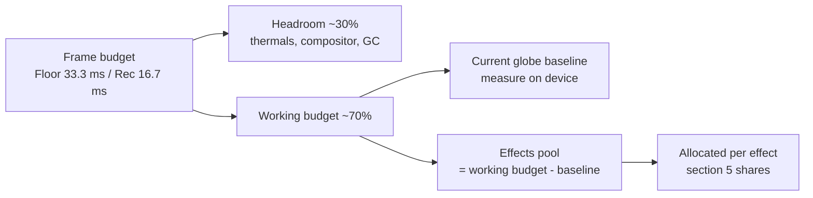
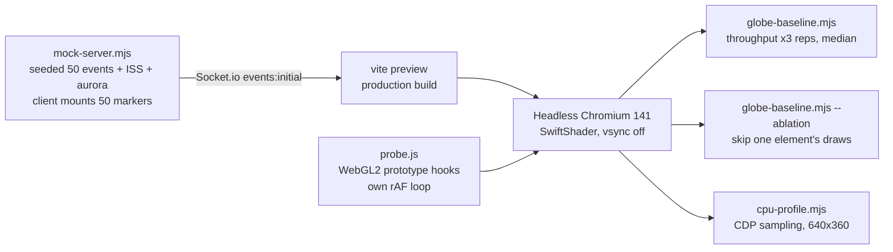
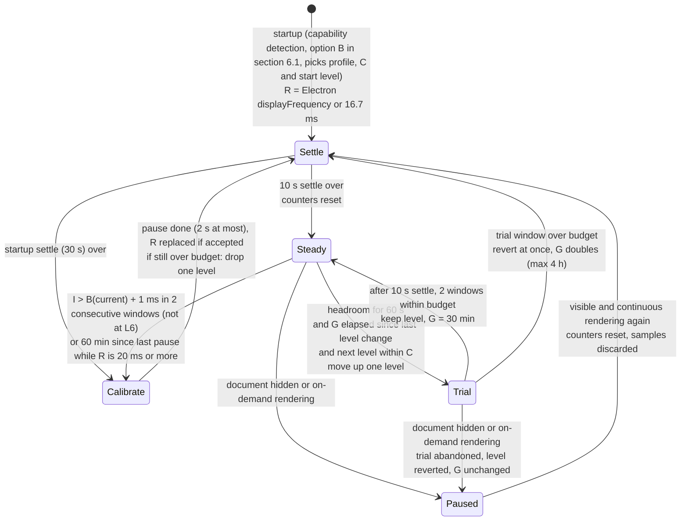

# Technical Specification: Display Targets and Frame Budget (Spike)

**Issue**: #384 (spike) | **Parent Feature**: #356 Performance and accessibility guardrails | **Epic**: #348 Living Globe
**Status**: Accepted (revision 3 merged in PR #438, `99fa237`), with a post-merge correction on 2026-10-19: the governor fixes from the "Re-review (revision 3, post-merge)" section of `docs/reviews/REVIEW-384.md` (B1, S1 to S6, the spec part of S9, O1 to O8) are applied to sections 3, 4.1, 6.2, 7, 8 and 10. A second correction on 2026-10-20 applies the "Final review of PR #440 (corrections)" section (N-B1, N-B2, N-S1 to N-S5 and the cheap optionals): the governor in section 6.2 was simplified (one 30 min trial gate, calibration pauses for `R`, ladder L0 to L6). Owner decisions (2026-10-18 and 2026-10-20) are in section 9; one item (night-lights texture source and licence) is still open.
**Author**: Architect agent | **Date**: 2026-10-18 (corrections 2026-10-19 and 2026-10-20)
**Location note**: this lives at `docs/specs/SPEC-384.md`, matching the existing `docs/specs/SPEC-{issue}.md` naming. There is no `docs/performance/` folder, and this spike doesn't create one.
**Tooling**: `scripts/perf/` (probe, mock backend, runners, on-device procedure in `scripts/perf/README.md`). Nothing in `src/` was changed.

> **How to read the numbers.** Every number is labelled with how it was measured. Container numbers come from headless Chromium 141 using **SwiftShader software GL** on a 4-vCPU Intel Xeon 2.1 GHz VM. That makes them good for **relative** comparisons (element A vs B, 1080p vs 4K, 0 vs 50 markers) and for **exact counts** (draw calls, triangles, texture bytes). They are **not** an estimate of fps on any real display. Hardware targets below are **assumptions** until someone runs the on-device procedure.

---

## 1. Summary

| Question                         | Answer                                                                                                                                                                                                                                                                                                                                         |
| -------------------------------- | ---------------------------------------------------------------------------------------------------------------------------------------------------------------------------------------------------------------------------------------------------------------------------------------------------------------------------------------------- |
| Lowest supported display         | **Decided (owner, 2026-10-18):** Raspberry Pi 5 driving a 1080p TV. A different floor device may replace it if it needs fewer tradeoffs. Broad backwards compatibility is not required. Built-in smart-TV browsers are not a supported render host.                                                                                            |
| Frame budget                     | Floor tier: 30 fps (33.3 ms), p95 50 ms or less. Recommended and Showpiece tiers: 60 fps (16.7 ms), p95 20 ms or less.                                                                                                                                                                                                                         |
| What the current globe costs     | 265 draw calls, 42.6k triangles, 58.2 MiB of textures at 50 markers (exact). The marker system is **about 74% of draw calls** (196 of 265) and adds about **4 ms/frame of main-thread JS** on the container CPU. Fill cost is led by the earth sphere, then the atmosphere shells and the wireframe overlay. Device pixel ratio is not capped. |
| Effects that need a lite path    | Phosphor bloom, sweep and ping, pulse-ring expansion, and fire-marker animation and count. Terminator, callout and alert dim stay cheap if built as specified, so they need no lite variant (section 6).                                                                                                                                       |
| Prerequisites before new effects | Explicit DPR cap, instanced markers and rings, a quality profile with a frame-time governor, and a draw-call/texture regression check (section 8).                                                                                                                                                                                             |

---

## 2. Target hardware tiers (Floor choice decided 2026-10-18; device capabilities still unverified)

None of these devices was available to the spike. Device capabilities listed come from public specs and **have not been verified here**.

| Tier                        | Reference devices (assumed)                                                                                                                           | Runtime                                                                                             | Resolution and DPR cap                                                               | Default profile       |
| --------------------------- | ----------------------------------------------------------------------------------------------------------------------------------------------------- | --------------------------------------------------------------------------------------------------- | ------------------------------------------------------------------------------------ | --------------------- |
| **Floor** (minimum)         | Raspberry Pi 5 (4 GB or more, VideoCore VII, WebGL2 through Mesa) on a 1080p TV                                                                       | Chromium kiosk or Electron arm64                                                                    | 1920x1080, DPR cap **1.0**                                                           | Lite                  |
| **Recommended**             | Mini PC or laptop with Intel Iris Xe-class iGPU or Apple M1; iPad Air/Pro (M1 or newer)                                                               | Electron (primary) or desktop Chrome/Safari on the mini PC or laptop; Safari on iPadOS for the iPad | 1080p to 1440p, DPR cap **1.5**                                                      | Full (bloom half-res) |
| **Showpiece**               | 4K TV or monitor driven by Apple M1 Pro or newer, or a discrete GPU (GTX 1660-class or better)                                                        | Electron                                                                                            | 3840x2160, DPR cap **1.0** at 4K (do not let OS scaling 2x push render size past 4K) | Full                  |
| **Unsupported render host** | Smart-TV built-in browsers (Tizen, webOS, Android TV WebView), Raspberry Pi 4 and older, iPad 9th gen and older (best effort, not a floor commitment) | Best effort only                                                                                    | Lite forced                                                                          | Lite                  |

"Unsupported" doesn't mean blocked. It means nobody commits to a budget for those devices. A TV is still supported as a **display**, driven over HDMI by a Floor-or-better device.

---

## 3. Frame-rate and frame-time budget per tier

CPU (main thread) and GPU work overlap, so each gets its own budget. About 30% of every frame is held back as headroom for thermals (always-on, often fanless), browser compositing and GC.

| Tier        | Target fps | Frame time | p95 frame     | Frames over 66 ms      | Main-thread JS per frame | GPU per frame | Texture memory cap | DPR cap |
| ----------- | ---------- | ---------- | ------------- | ---------------------- | ------------------------ | ------------- | ------------------ | ------- |
| Floor       | 30         | 33.3 ms    | 50 ms or less | 1% or less over 10 min | 16 ms or less            | 23 ms or less | 64 MiB             | 1.0     |
| Recommended | 60         | 16.7 ms    | 20 ms or less | 0.1% or less           | 8 ms or less             | 11 ms or less | 96 MiB             | 1.5     |
| Showpiece   | 60         | 16.7 ms    | 20 ms or less | 0.1% or less           | 8 ms or less             | 11 ms or less | 128 MiB            | 1.0 @4K |

Column to probe field mapping (`scripts/perf/probe.js`, `__wpPerf.stop().summary`). All frame metrics count **application rendered frames**: a browser `requestAnimationFrame` tick counts as a rendered frame only if the app issued at least one draw call since the previous tick (`renderedFrames`, `fpsMean`, `frameMs*`, `framesOver*`, and every per-frame draw-call and triangle count). Browser cadence is reported separately (`rafTicks`, `rafFpsMean`, `rafIntervalMsP50`, `rafIntervalMsP95`), so a 30 fps cap on a 60 Hz display reads as about 30 rendered fps against about 60 rAF fps. Today the globe uses r3f's default `frameloop="always"` (`Globe.tsx`, `<Canvas>` without a `frameloop` prop), so the two are equal; they diverge once the L5/L6 cap or a calibration pause (section 6.2), or on-demand rendering, exists. p95 frame is `frameMsP95`; frames over 66 ms is `pctFramesOver66ms` (count in `framesOver66ms`); main-thread JS is `rafCallbackMsP95`. `rafCallbackMsP95` is measured per rAF callback, not per frame; that equals per frame today because the app has one render loop (r3f) and no other `requestAnimationFrame` users in `src/`, and it must be re-checked if another rAF user is added. The probe also reports `framesOver33ms` and `framesOver50ms`; these are informative only (at a 30 fps Floor almost every frame is about 33.3 ms, so frames over 33 ms is not a budget metric).

**Timestamp tolerance.** Budget comparisons allow 1 ms for timestamp jitter: a p95 of 50.9 ms meets a 50 ms budget, and 51.1 ms misses it. This matters because 50 ms is exactly three ticks at 60 Hz, so at a 30 fps Floor or under the L5/L6 cap every once-slipped frame lands on 50.0 ms plus or minus jitter; without a tolerance the "p95 50 ms or less" check would pass or fail at random. The governor uses the same rule (`I > B + 1 ms` is over budget, section 6.2). The probe's `framesOver*` counters apply the same 1 ms tolerance (`TOL_MS` in `scripts/perf/probe.js`, changed in the same follow-up, PR #440). GPU per frame has no probe field: it needs `EXT_disjoint_timer_query_webgl2` or a platform GPU profiler on the device (section 4.5). Texture memory is the probe's `textureUploadMiB` (cumulative allocations; see AC 6).

Budget split for one frame:

**Hardware-independent ceilings.** These are exact, measurable in CI with `scripts/perf/probe.js` against the mock backend at 50 markers, and they hold on every tier:

| Metric                                          | Today (measured)             | Ceiling with all default-on effects (Full)                          | Ceiling (Lite)                              |
| ----------------------------------------------- | ---------------------------- | ------------------------------------------------------------------- | ------------------------------------------- |
| Draw calls per frame                            | 265                          | 300 (effects add 35 or fewer in total); 120 after marker instancing | 80 (only reachable after marker instancing) |
| Triangles per frame                             | 42,552                       | 100,000                                                             | 60,000                                      |
| Distinct shader programs (startup compile cost) | 10 (probe `programsCreated`) | 16                                                                  | 12                                          |
| Texture allocations incl. mipmaps               | 58.2 MiB                     | 96 MiB                                                              | 64 MiB                                      |
| Full-screen post-processing passes              | 0                            | 4 (bloom at half res)                                               | 0                                           |
| Per-frame React state updates from `useFrame`   | 1 (`CityLabelsWithTracking`) | 0 new                                                               | 0 new                                       |

---

## 4. Measurement method, results and limitations

### 4.1 Method

- The **probe** tags each WebGL program by its shader source (custom-shader uniforms, three.js `SHADER_TYPE` defines) and splits `MeshBasicMaterial` by geometry signature. It counts draw calls and primitives, records `texStorage2D` allocations, times rAF callbacks, and measures intervals between rendered frames and between rAF ticks separately (section 3). Per-element counts are accumulated inside completed frame records only, so they sum exactly to the per-frame total. It also reports the unmasked WebGL renderer string and the shader program count. The app itself isn't instrumented.
- **Throughput** runs: 4 s warm-up, then 10 s sampled, uncapped. Each runs 3 times interleaved and the median is reported. Mean frame time is 1000 / median fps.
- The `gl.finish()` attribution scenarios run only with `--attribution` (section 4.5 explains why their output is excluded). Without them, `globe-baseline.mjs --quick` completed in 248 s in the container (6 scenarios, 1 rep).
- **Ablation** skips one element's draw calls. That removes its raster and submission cost but not its CPU scene-graph cost.
- **CPU profile** runs at 640x360 so software fill doesn't stall the main thread, then buckets self time by bundle chunk. The `--startup` variant reports totals over the profiler's elapsed time, not per-frame rates.
- **Measured source revision.** The exact counts in section 4.2 describe `src/` as of `7dbd9d5` (the last commit that touched `src/`) built with three 0.186.1 (`903d71c`). They were measured on a `vite build` of pre-squash branch commit `12bec81`; the citable revision is `99fa237` on `main` (the PR #438 merge), whose `src/` is identical (`git diff --quiet 7dbd9d5 99fa237 -- src` exits 0) and whose fresh `vite build` reproduces the section 4.2 bundle sizes exactly (post-merge review).

### 4.2 Results: exact scene counts (hardware-independent)

| Item                         | Value                                                                                                                                                                                                                          | Source               |
| ---------------------------- | ------------------------------------------------------------------------------------------------------------------------------------------------------------------------------------------------------------------------------ | -------------------- |
| Draw calls/frame, 50 markers | 265 = markers 196 + labels 58 + earth 1, wireframe 1, graticule 1, atmosphere 2, stars 1, city lights 1, aurora 2, ISS 2. Markers: 50 mounted (cap) = 50 spheres + 50 x 2 ring passes + 23 x 2 pulse-ring passes (section 4.4) | probe per-tag count  |
| Draw calls/frame, 0 markers  | 77 (includes 8 marker draws for the ISS and aurora events, which also get event markers)                                                                                                                                       | probe                |
| Triangles/frame              | 42,552 (markers ~20.2k, earth ~9.3k, atmosphere ~8.2k, aurora ~4.7k, ISS ~0.8k). Line vertices: 15,424 (wireframe sphere, graticule). Points: 858                                                                              | probe                |
| Texture memory               | 58.2 MiB: earth map 4096x2048 with 13 mip levels (~42.7 MiB), normal map 2048x1024 (~10.7 MiB), 58 label sprite textures 256x64 (~85 KiB each; one per city, 58 cities in `cityData.ts`)                                       | probe `texStorage2D` |
| JS heap                      | 14.8 to 15.8 MiB after load                                                                                                                                                                                                    | `performance.memory` |
| Bundle                       | vendor-three 1,168.6 kB (324.3 kB gzip), main 601.4 kB (136.1 kB gzip), CSS 44.8 kB (9.3 kB gzip)                                                                                                                              | `vite build` output  |

### 4.3 Results: relative costs (SwiftShader, container; do not read as device fps)

Throughput, 1080p, median of 3:

| Scenario                         | fps (range)      | Mean frame ms | vs baseline   |
| -------------------------------- | ---------------- | ------------- | ------------- |
| Clear only (all draws skipped)   | 49.2 (46.7–49.4) | 20            | floor of page |
| Empty globe (0 markers)          | 8.4 (4.4–8.5)    | 119           | noisy         |
| **Baseline (50 markers), DPR 1** | 3.3 (3.2–3.5)    | 303           | 1.0x          |
| Baseline, DPR 2                  | 1.5 (1.4–1.6)    | 667           | 2.2x slower   |
| Baseline, 4K DPR 1               | 1.4 (1.4–1.6)    | 714           | 2.4x slower   |
| Baseline, reduced motion         | 4.0 (3.9–5.4)    | 250           | within noise  |

Ablation, 1080p, DPR 1, 50 markers, median of 3:

| Element skipped                                    | Frame ms | Saved vs 303 ms | Share |
| -------------------------------------------------- | -------- | --------------- | ----- |
| Earth sphere (`MeshStandardMaterial` + normal map) | 208      | 95              | ~31%  |
| Atmosphere (2 additive back-face shells)           | 250      | 53              | ~17%  |
| Wireframe overlay sphere                           | 250      | 53              | ~17%  |
| Markers (50 spheres, 50 rings, 23 pulse rings)     | 263      | 40              | ~13%  |
| City labels (58 sprites)                           | 286      | 17              | ~6%   |
| Stars                                              | 313      | 0 (noise)       | ~0%   |

Main-thread CPU (CDP sampling profile, 640x360, 10 s):

| Metric                                   | 0 markers | 50 markers |
| ---------------------------------------- | --------- | ---------- |
| rAF callback mean / p95 (ms)             | 1.7 / 3.5 | 5.8 / 10.8 |
| Non-idle main-thread ms per frame        | ~3.0      | ~8.3       |
| three.js + r3f chunk self time per frame | 1.0       | 3.5        |
| React + app chunk self time per frame    | 0.02      | 0.09       |

Startup (CDP profile from navigation to first draw):

| Metric                     | Value                                                                                                                                                                                      |
| -------------------------- | ------------------------------------------------------------------------------------------------------------------------------------------------------------------------------------------ |
| First WebGL draw after nav | 6.5 to 7.0 s                                                                                                                                                                               |
| Long tasks                 | ~1.4 to 1.6 s, then ~5.8 to 6.1 s                                                                                                                                                          |
| Attribution                | ~6.1 s in three.js program link-status check, a synchronous wait on shader compile. Its size is specific to SwiftShader. Another ~1.1 s goes to `generateHeightCanvas` (app JS, CPU-bound) |

### 4.4 Findings for the existing scene

1. **The marker system drives draw calls and main-thread cost.** In `src/renderer/components/Globe/Globe.tsx`, `EventMarkers` sorts located events (featured first, then severity, then recency), drops any within 5 degrees of an already kept marker (`deduplicateNearbyEvents`) and stops at `MAX_MARKERS = 50`. It renders `EventMarker`, `EventRing` and `EventPulseRing` only for that selection. That is two or three meshes per mounted marker: the pulse-ring mesh renders only at severity 5 or more or when featured, but all three `useFrame` callbacks are registered for every mounted marker, because `EventPulseRing` calls `useFrame` before its early return. Both rings are transparent and `THREE.DoubleSide`, so three.js draws each one twice (back faces, then front faces). The mock sends 52 located events (50 synthetic plus ISS and aurora). None is dropped by the 5-degree rule; the 50-marker cap drops the two lowest-severity events (`perf-10` at 0.1 and `perf-41` at 0), so 50 markers mount, ISS and aurora included. 23 of them render a pulse ring (severity 5 or more; the featured event, `perf-1` at 9, is among them). So 50 x 1 sphere + 50 x 2 ring passes + 23 x 2 pulse-ring passes = 196 of 265 draw calls (about 74%). This was counted in the page, not only derived: per rendered frame the probe saw 50 draws with the 12x12 sphere signature (792 indices) and 146 with the ring signature (144 indices), and no home-beacon draws (geolocation is not granted headless). The earlier "52 events, 20 pulse rings" breakdown was wrong; the measured 196 was not. The marker system also adds about 4 ms/frame of main-thread JS on a server-class core. Planned pulse rings and fire markers would make this worse unless they are instanced.
2. **DPR is uncapped.** r3f's default `dpr` is `[1, 2]`. An iPad or a 2x-scaled 4K desktop renders 4x the pixels. DPR 2 was 2.2x slower here, which matters most for fill-bound effects such as bloom and sweep.
3. **Fill cost sits in a few full-globe layers.** Earth, two atmosphere shells and the wireframe overlay. These are the natural lite levers for existing content. The wireframe's 17% share may be exaggerated by SwiftShader line rasterisation, so check it on a device.
4. **Reduced motion doesn't reduce work.** It zeroes shader amplitudes, but the scene still renders every frame and auto-rotation continues.
5. **Labels draw even when hidden.** 58 sprites (`CityLabels.tsx`, one per city in `cityData.ts`) each have their own texture and draw call. Hidden tiers use opacity 0, so they are still submitted.
6. **Startup grows with shader count.** Every new effect program adds compile time to first frame. On Pi-class GPUs this is unknown and needs on-device measurement.
7. **Minor:** `CityLabelsWithTracking` calls `setState` from `useFrame` every frame. React bails out when the distance is unchanged, so the cost appears only while zooming. Don't copy this pattern in new effects.

### 4.5 Limitations (what was not measured)

- **No real GPU, Pi, iPad or Electron build was measured.** Every absolute fps number above is software rendering. None of the tier fps targets has been validated.
- **No GPU timer data.** `EXT_disjoint_timer_query_webgl2` isn't available under SwiftShader. The probe's `gl.finish()` attribution mode turned out to measure submission overhead, not raster: the earth draw read 0.03 ms. Its numbers are excluded here and the caveat is documented in `probe.js`.
- **Non-additive and noisy.** The empty-scene run varied 2x between reps. Ablation savings sum to about 84% of frame time. Treat shares as rank order, not precise fractions.
- **Not measured:** power draw, thermals over hours, memory growth over 24 h, Safari/WebKit behaviour, and the DOM/CSS cost of side columns and ticker on low-end CPUs. On SwiftShader the clear-only floor of 20 ms suggests it is small but not zero.
- **The CPU number is for the container CPU.** A Pi 5 core is expected to be several times slower. That is an assumption, so measure it.

---

## 5. Per-effect cost allocation (planned Living Globe effects)

The shares divide the **effects pool** from section 3. The pool is the working budget minus the on-device baseline. Draw-call and texture limits are hard ceilings and don't depend on hardware.

Texture arithmetic (baseline 58.2 MiB, sizes include a full mip chain at 4 bytes per texel): the night texture is 1024x512 or smaller on every tier (owner, section 9), so it adds at most 2.7 MiB, giving 60.9 MiB. That leaves about 35 MiB under the 96 MiB Full ceiling for bloom render targets and other effects, and about 3 MiB under the 64 MiB Floor/Lite cap. Lite has no bloom, so no extra render targets.

| Effect (feature)                                           | Main cost driver                                    | Hard limits (Full)                                                                                                                              | Pool share | Floor / Lite behaviour                                                                                                                                           | Needs lite?            |
| ---------------------------------------------------------- | --------------------------------------------------- | ----------------------------------------------------------------------------------------------------------------------------------------------- | ---------- | ---------------------------------------------------------------------------------------------------------------------------------------------------------------- | ---------------------- |
| Solar terminator + shader city lights (#357)               | Fragment math on earth; optional night texture      | +0 draw calls (extend existing materials); sun direction updated at 1 Hz or slower, not per frame; night texture 1024x512 or smaller (+2.7 MiB) | 10%        | Same shader and texture size (or no night texture: existing city points only); the L6 simplified earth keeps the terminator and night-lights terms (section 6.2) | No (texture size only) |
| Magnitude pulse rings (#359)                               | Draw calls, overdraw of expanding transparent rings | 2 draw calls or fewer total (instanced); 8 or fewer concurrent animated rings; 0.3 ms or less JS per frame                                      | 10%        | 3 or fewer concurrent; static ring (no expansion) when degraded or reduced motion                                                                                | **Yes**                |
| Tactical callout (#358)                                    | Per-frame screen-space projection and DOM layout    | 1 callout; 1 draw call or fewer for leader line; position updated by ref/transform with no React state per frame; 0.5 ms or less                | 5%         | Position update at 10 Hz or slower                                                                                                                               | No                     |
| Sweep and ping (#360)                                      | Fill: one additive shell or disc over the globe     | 2 draw calls or fewer; ping driven by a uniform on instanced markers, never per-marker meshes                                                   | 15%        | **Off** at Floor; first to auto-disable after bloom                                                                                                              | **Yes**                |
| Phosphor overlay: scanlines, bloom, vignette, drift (#362) | Bloom: offscreen render target + blur passes        | Scanlines, vignette and drift as static CSS layers (0 WebGL draws); bloom at half res, 4 passes or fewer                                        | 35%        | CSS scanlines, vignette and drift only; **no bloom**                                                                                                             | **Yes**                |
| Fire markers with clustering (#367, FIRMS)                 | Instance count, clustering CPU                      | 1 draw call for all fires; 1,000 or fewer cluster instances; clustering only on data arrival (server-side or worker), never per frame           | 15%        | 250 or fewer instances; no per-fire animation                                                                                                                    | **Yes**                |
| Alert dim and recenter (#361)                              | CSS opacity transition; existing rotation lerp      | 0 extra draw calls; no material `defines` toggles (avoid shader recompiles mid-alert)                                                           | 5%         | Same; reduced motion: cut instead of animated recenter                                                                                                           | No                     |
| Reserve                                                    |                                                     |                                                                                                                                                 | 5%         |                                                                                                                                                                  |                        |

---

## 6. Lite fallback and auto-degrade

### 6.1 Options considered

| Option                                                                                                                       | Pros                                                      | Cons                                                                                                |
| ---------------------------------------------------------------------------------------------------------------------------- | --------------------------------------------------------- | --------------------------------------------------------------------------------------------------- |
| A. Manual profile only (Full or Lite in settings)                                                                            | Simple, predictable, no runtime logic                     | Wrong default on unknown hardware; owner must notice the stutter first                              |
| B. Capability detection at startup (renderer string, `hardwareConcurrency`, `deviceMemory`, screen size, `MAX_TEXTURE_SIZE`) | Sensible first frame; no flicker                          | Heuristics go stale; can't see thermals or other tabs; renderer strings are masked on some browsers |
| C. Runtime frame-time governor with hysteresis                                                                               | Responds to real conditions, including thermal throttling | Needs tuning; risks visible quality oscillation if hysteresis is wrong                              |

**Decision (proposed): B picks the initial profile, C adjusts at runtime, and A is an override.** The settings choice is Auto, Full or Lite, and Auto is the default. A manual choice caps the governor: it never steps above what the user picked. This is the only approach that covers both "unknown device on first boot" and "fanless Pi throttling after 3 hours".

### 6.2 Degrade ladder (governor steps down in this order, back up in reverse)

| Level | Change                                                                                                                                                                                                                                                | Reason for position                                                                                                                                                            |
| ----- | ----------------------------------------------------------------------------------------------------------------------------------------------------------------------------------------------------------------------------------------------------- | ------------------------------------------------------------------------------------------------------------------------------------------------------------------------------ |
| L0    | Full                                                                                                                                                                                                                                                  |                                                                                                                                                                                |
| L1    | Bloom off (phosphor drops to CSS only)                                                                                                                                                                                                                | Biggest planned fill cost, purely decorative                                                                                                                                   |
| L2    | Sweep and ping off                                                                                                                                                                                                                                    | Opt-in decoration, full-globe fill                                                                                                                                             |
| L3    | Pulse rings static, 3 or fewer concurrent; fire markers no animation, 250 or fewer instances                                                                                                                                                          | Keeps information, drops motion                                                                                                                                                |
| L4    | DPR cap 1.0                                                                                                                                                                                                                                           | Largest single fill lever (2.2x, container SwiftShader, relative only)                                                                                                         |
| L5    | 30 fps frame cap (see the cap rule below); outer atmosphere shell and wireframe overlay off                                                                                                                                                           | Existing fill-heavy decoration (about 17% each, container SwiftShader ablation, rank order only); the cap halves the work at 60 Hz and above                                   |
| L6    | Simplified earth material (normal map off, cheaper lighting) that **keeps the terminator and night-lights terms from #357**. Reached only by the governor: never a profile ceiling, a starting level or part of the Floor fallback (AC 8, section 10) | Largest single cost (earth about 31%, container SwiftShader ablation, rank order only). The owner accepted it at the governor's last-resort level only (section 9, 2026-10-20) |
| Never | Event markers, severity colours and labels, alert behaviour, terminator and night lights (kept at every level, L6 included)                                                                                                                           | Core information; colour-independence rules from #385                                                                                                                          |

**Profiles and the ladder.** Each profile sets a ceiling `C`, the best level the governor may reach, and the starting level. The governor works between `C` and L6, and the effective level is the more degraded of `C` and the governor's level (story #431).

| Profile | Ceiling `C` and starting level                                                                                                                                             |
| ------- | -------------------------------------------------------------------------------------------------------------------------------------------------------------------------- |
| Full    | `C` = L0; starts at L0                                                                                                                                                     |
| Lite    | `C` = L4: all of L1 to L4 applied (bloom off, sweep and ping off, static pulse rings 3 or fewer, fires 250 or fewer and static, DPR 1.0 or less; story #431); starts at L4 |
| Auto    | Recommended and Showpiece: `C` = L0, starts at L0. Floor: `C` = L4, starts at L4 (Floor's default profile is Lite, section 2)                                              |

L5 and L6 are reached only by the governor; no profile starts there. The one exception is the AC 8 fallback: if the owner re-baselines Floor, Floor's ceiling and start become L5, never L6. A user choice of Full on a Floor device is allowed and lets the governor reach L0.

**Why step-up can't use frame intervals.** A vsync-limited renderer on a 60 Hz display produces intervals of about 16.7 ms even when it is nearly idle. The earlier rule ("p95 under 70% of budget", 14 ms for Recommended and Showpiece) could therefore never be met at 60 Hz, so those tiers could degrade but never recover. At L5 and L6 the 30 fps cap holds intervals at about 33.3 ms, so no tier could leave them either. Step-down stays interval-based, because missed frames are what the viewer sees. Step-up uses render-work headroom, followed by a short trial at the better level that reverts if the budget is missed.

**Why `R` is measured in a calibration pause.** Browsers run one rAF callback per main-thread frame. When the app renders on every tick, a slow render delays the next tick, so the rAF interval equals the achieved frame time, not the display refresh. A device stuck at a steady 30 fps on a 60 Hz panel then looks exactly like a 30 Hz display, and an interval budget floored at 1.2 x that `R` grows with the slowdown and never trips (revision 3 defect B1: the governor never stepped down, including on the Pi 5). `R` is therefore measured only in a short calibration pause in which the app renders nothing, and is passed to the governor as an input. A pause runs before every step-down, so a wrong `R` is re-measured exactly when it would cause a step-down, and periodically while `R` is high enough to hide overload.

**One frame-loop owner.** The canvas uses r3f `frameloop="never"`, and a single app rAF loop calls `advance()`. Only that loop decides, per tick, whether to render: every tick normally, the cap rule at L5 and L6, nothing during a calibration pause, and only after an invalidation when on-demand rendering is active (#385 drives its invalidations through this loop rather than setting `frameloop="demand"` itself). A skipped tick skips the whole frame, `useFrame` callbacks included, because the power saving depends on it; animations use clock time, so motion speed doesn't change. The loop reports render boundaries and rAF ticks to the governor.

**`Paused`: hidden document and on-demand rendering.** While the document is hidden, or while on-demand rendering is active (reduced motion, #385, decided 2026-10-20), the governor is `Paused`: it takes no samples, starts no step-down, trial or calibration pause, and holds the level. On-demand intervals are seconds long by design, so reading them as frame intervals would step down to L6 every time reduced motion is on. Samples taken while `Paused` and the interval that spans the paused period are discarded.

Governor signals, computed per 10 s window from **rendered frames** only (the same definition as the probe, section 3; the governor counts render boundaries inside the app, so ticks skipped by the cap or a calibration pause are not frames).

| Signal            | Definition                                                                                                                                                                                                                                                                                                                                                                                                                                                                                                                                                                                                                                                                                                                                                                                                                                                                                                                                                           |
| ----------------- | -------------------------------------------------------------------------------------------------------------------------------------------------------------------------------------------------------------------------------------------------------------------------------------------------------------------------------------------------------------------------------------------------------------------------------------------------------------------------------------------------------------------------------------------------------------------------------------------------------------------------------------------------------------------------------------------------------------------------------------------------------------------------------------------------------------------------------------------------------------------------------------------------------------------------------------------------------------------- |
| `I`               | p95 interval between consecutive rendered frames                                                                                                                                                                                                                                                                                                                                                                                                                                                                                                                                                                                                                                                                                                                                                                                                                                                                                                                     |
| `R`               | display refresh interval (about 16.7 ms at 60 Hz), an injected input to the governor. Initial value: in Electron, the `displayFrequency` of the display that holds the window (`screen.getDisplayMatching`, read over IPC) when it is non-zero; otherwise 16.7 ms. After that, `R` is the result of the most recent accepted calibration pause, so a wrong initial value is replaced the first time a pause runs. `R` is never derived from intervals in which the app rendered, because there the rAF interval is the render time                                                                                                                                                                                                                                                                                                                                                                                                                                   |
| calibration pause | the app renders nothing (the last frame stays on screen) until it has 20 rAF intervals of 100 ms or less, or for 2 s at most (about 0.33 s at 60 Hz, 0.8 s at 24 Hz). The result is the **10th percentile** of those intervals. It is accepted only if at least 10 intervals were collected, the median is within 15% of the 10th percentile and the result is between 4 and 42 ms; an accepted result replaces `R`, a rejected one leaves `R` unchanged. A pause runs only (1) when the startup settle period ends, (2) before every step-down (a failed trial reverts without one), (3) after a screen or refresh-rate change (`window.screen` or `devicePixelRatio` change, Electron `display-metrics-changed`; the initial value is re-read first), and (4) 60 min after the previous pause while `R` is 20 ms or more (a display at 50 Hz or slower: below 20 ms, 1.2 x `R` + 1 ms stays under two 60 Hz ticks, so a wrong-high `R` cannot hide a missed frame) |
| `W`               | p95 render work per rendered frame: the **larger** of the p95 main-thread time of the render-loop callback (all `useFrame` callbacks plus `gl.render`) and the p95 GPU time from `EXT_disjoint_timer_query_webgl2`. CPU and GPU work overlap (section 3), so they are not added. GPU results arrive a few frames late, and disjoint results are discarded. Where the extension is unavailable (expected on Safari and on the Pi; to be confirmed on device, section 4.5), `W` is the main-thread time only and the governor records the GPU time as unknown                                                                                                                                                                                                                                                                                                                                                                                                          |
| `B(level)`        | interval budget: the tier p95 budget (Floor 50 ms, Recommended and Showpiece 20 ms) for L0 to L4; 50 ms at L5 and L6 on every tier (the 30 fps cap's own budget). Never below 1.2 x `R`, so a genuinely slow display (for example a 30 Hz TV mode) is not read as overload. A window is **over budget** when `I > B + 1 ms` (section 3 tolerance)                                                                                                                                                                                                                                                                                                                                                                                                                                                                                                                                                                                                                    |
| `T(next)`         | target frame interval of the next better level: the larger of `R` and that level's frame time (the tier frame time, 33.3 ms Floor or 16.7 ms Recommended and Showpiece, for L0 to L4; 33.3 ms for the capped L5). Only evaluated for the next better level                                                                                                                                                                                                                                                                                                                                                                                                                                                                                                                                                                                                                                                                                                           |
| headroom          | a window has headroom when it is not over budget and `W` is at most 50% of `T(next)` with GPU time known, or at most 40% of `T(next)` with GPU time unknown. The stricter threshold leaves room for GPU cost the governor can't see; the trial stays the final check. Thresholds: Recommended and Showpiece 8.35 ms (known) or 6.7 ms (unknown); Floor, and a trial of L5 from L6 on any tier, 16.7 ms or 13.3 ms                                                                                                                                                                                                                                                                                                                                                                                                                                                                                                                                                    |
| settle            | windows discarded after a transition: 30 s after the first rendered frame at startup, and 10 s (one window) after every level change (step-down, trial start, trial revert), every calibration pause and every return from `Paused`. Startup covers the first-frame shader compile (about 6 s on SwiftShader, section 4.3, unknown on the Pi), texture upload and the initial event burst; a level change can reallocate the drawing buffer (L4 DPR change)                                                                                                                                                                                                                                                                                                                                                                                                                                                                                                          |
| precompile        | on entering a level, the app precompiles (three.js `compileAsync`) the programs of the next better and the next worse level, so neither a trial nor a step-down waits for a shader compile and the settle window only has to absorb allocation hitches. The L6 earth program is therefore compiled when L5 is entered, at least 30 s before the earliest step-down to L6, and never at startup, so it does not count against the section 3 startup program ceilings                                                                                                                                                                                                                                                                                                                                                                                                                                                                                                  |
| counters          | the consecutive over-budget window count and the headroom time both reset to zero on any level change, calibration pause, settle period and `Paused`                                                                                                                                                                                                                                                                                                                                                                                                                                                                                                                                                                                                                                                                                                                                                                                                                 |
| trial gate `G`    | a trial starts only if at least `G` has passed since the last level change of any kind (startup, step-down, trial start, trial revert). `G` is 30 min. It doubles after each failed trial, up to 4 h, and returns to 30 min when a trial is kept. Nothing else changes `G`. A trial abandoned because the governor entered `Paused` reverts without changing `G`, and the gate counts from that revert                                                                                                                                                                                                                                                                                                                                                                                                                                                                                                                                                               |
| cap (L5 and L6)   | the frame loop renders on a tick only when the time since the last render is at least 33.3 ms minus `R`/2, and the cap is a no-op when `R` is 30 ms or more. So 60 Hz and 120 Hz give 30 fps, 144 Hz about 29 fps, 75 Hz about 31 fps (a mix of 26.7 and 40 ms intervals), 50 Hz 25 fps, and 30 Hz or 24 Hz displays are not slowed further                                                                                                                                                                                                                                                                                                                                                                                                                                                                                                                                                                                                                          |

Step-down: two consecutive over-budget windows (outside a settle period) start a calibration pause. If the window that just closed is still over budget with the resulting `R`, the governor drops exactly one level; otherwise nothing changes, because the "overload" was a slow display read with a wrong `R`. Either way the counters reset and a settle window follows. Under sustained overload the first step-down therefore comes 20 s after the overload starts (at a window boundary) and each further one 30 s later, each plus its pause (at most 2 s; about 0.33 s at 60 Hz): **L0 to L5 takes 140 s and L0 to L6 takes 170 s after the overload starts**, plus the pauses. From startup, the first step-down comes 60 s after the first rendered frame (30 s settle, the startup pause, a 10 s settle, two windows). At L6 a further step-down is a no-op and runs no pause.

Step-up: six consecutive headroom windows (60 s), the trial gate `G` elapsed, and the next level within `C` start a trial one level up. After the 10 s settle window, the trial needs 2 windows within budget (30 s in total) to be kept, and `G` returns to 30 min. A trial window over budget reverts the trial at once, without a calibration pause, and `G` doubles.

Level-change bound, by arithmetic. Every step-up is a trial start, and a trial start needs at least 30 min since the previous level change, which includes the previous trial start. So whatever the load there are **at most 2 step-ups in any 60 min window and at most 48 in 24 h**. Every other change is a step-down or a revert, and over any period step-downs exceed step-ups only by the number of levels the governor ends up lower, at most 6. Hence:

- **Load that overloads only the profile's top level** (for example L0 on Full): the governor only moves between that level and the next, alternating, so at most 4 level changes in any 60 min window (down, up 30 min later, down; or up, down, up, down) and at most 97 in 24 h.
- **Any load:** at most 10 level changes in any 60 min window and at most 102 in 24 h.

The throwaway window-level model (session 5 in `docs/progress/ISSUE-384-log.md`) agrees: on the fine burst grid (on-time 0.5 to 10 min in 0.5 min steps, every whole-minute period from 3 to 120 min, 8 phases, 24 h), load at L0 only gave at most 4 changes in any hour and 93 in 24 h; bursts that overload up to six levels gave at most 9 in any hour and 98 in 24 h; 300 random burst schedules stayed within the same numbers. The reviewer's failing case (6 min of load every 46 min) gives 3 per hour and 63 per day.

Worked cases, checked in a throwaway window-level model of these rules (not committed; results in `docs/progress/ISSUE-384-log.md`, session 5):

- **Recommended, 60 Hz, unloaded, at L1**, `W` 4 ms: eligible (4 ms is under 8.35 ms, or under 6.7 ms without a GPU timer). Trials L0 30 min after the last level change (or startup), sees `I` of about 16.7 ms (under 20 + 1 ms) and keeps L0 30 s later.
- **Recommended at L5 or L6, capable device:** rendered intervals sit at about 33.3 ms because of the cap, but `W` shows headroom, so it trials the next level; L4 renders at 60 fps and is kept only if `I` stays within 20 + 1 ms. L5 to L0 takes 5 kept trials 30 min apart (L0 at about 150 min); L6 to L0 takes 6 (about 180 min). That slow climb is the price of the single 30 min gate (section 10); a burst that cost one level is recovered in 30 min.
- **Overload, Recommended, 60 Hz, steady 30 fps at L0 to L3:** every pause measures `R` 16.7 ms, so `B` is 20 ms and `I` of 33.4 ms is over budget. It steps down at 60, 90, 120 and 150 s from startup to L4, where the device holds 60 fps. With `W` 14 ms it never trials L3; with `W` 4 ms and GPU time unknown, trials of L3 fail at 32.5, 93, 213 and 454 min, then every 4 h.
- **Overload, Floor Pi 5 on a 60 Hz TV, steady 15 fps:** `R` 16.7 ms, `B` 50 ms, `I` about 67 ms: steps down from L4 to L5 and L6 (60 and 90 s from startup). The cap doesn't help a device that can't reach 30 fps; L5 and L6 remove the most fill they can. AC 8 counts a Floor row only if it meets the budget at L5 or better, never at L6.
- **Genuine 30 Hz display on Recommended:** the startup pause gives `R` 33.3 ms, so `B` is 40 ms and `I` of 33.3 ms is within budget: no step-down. If the startup pause was rejected, or Electron reported a wrong 60 Hz, `R` stays 16.7 ms until two windows read as over budget; the pause before the step-down measures 33.3 ms and cancels it, and no level ever changes. The same holds at 25 Hz and 24 Hz. From L1, `T(next)` is 33.3 ms, so headroom is easy and L0 is trialled and kept.
- **Floor on a 30 Hz display at L5:** the cap is a no-op (`R` 33.3 ms is 30 ms or more), so `I` is 33.3 ms rather than 66.7 ms and the governor can step back up to `C`.
- **Wrong-high `R` (a busy pause):** `R` 33 ms on a 60 Hz panel hides a steady 30 fps overload until the next hourly pause (`R` is 20 ms or more), which measures 16.7 ms; the step-downs follow (first at 61 min). If two pauses in a row are wrong, the first step-down is at 121 min. Overload worse than 1.2 x `R` + 1 ms is never hidden.
- **Residual, every pause unusable:** if every pause on a 30, 25 or 24 Hz display is rejected (the main thread is busy even while the app renders nothing), `R` stays 16.7 ms and the governor steps down to L5 and holds it, with a failed L4 trial at 33, 93 and 214 min, then every 4 h; it never reaches L6, because the L5 budget is 50 ms. If every pause instead returns the same stretched interval, `R` stays too high and overload up to 1.2 x `R` is not acted on. Both need the main thread to be slow while the app renders nothing, when stepping the ladder down could not help anyway.
- **GPU-bound without the timer extension:** `W` misses GPU time, so eligibility can be optimistic. A failing trial costs at most 20 s of missed frames when its first window fails (10 s settle plus one window), at most 30 s if the second window fails, at 30, 90, 211 and 451 min, then every 4 h.
- **Main-thread-bound Recommended device:** the container's rAF callback p95 at 50 markers was 10.8 ms (section 4.3), above the 8.35 ms headroom threshold. A device with a CPU like that never becomes eligible to leave L1 until marker instancing (AC 3) lands. That is consistent with the section 3 main-thread budget (8 ms), not a defect.
- **Intermittent load** (L0 overloaded for 1 min in every 6, fine at L1): 41 level changes in 24 h, at most 4 in any hour (the revision 3 rules gave 720 a day).

**What story #435 needs from this section:**

- a pure governor module with injected inputs: rendered-frame timestamps, rAF tick timestamps, per-frame main-thread work time and optional GPU time, the refresh interval `R`, the profile ceiling `C` and starting level, document visibility, an on-demand flag and a clock. Its outputs are the level, calibration-pause requests and precompile requests;
- a separate, unit-tested calibration function: pause intervals in, an accepted `R` or a rejection out, with the acceptance test in the table;
- one frame-loop owner (r3f `frameloop="never"` plus `advance()`) that renders every tick, applies the L5/L6 cap, holds frames during a calibration pause and, once #385 lands, renders on demand;
- hidden documents and on-demand rendering treated as `Paused`;
- the signal definitions in the table, the state machine in the diagram (settle periods, counter resets, calibration pauses, the trial and the trial gate `G`), and precompiling the neighbouring levels on every level change;
- the unit tests listed in AC 5.

---

## 7. On-device measurement procedure

The full checklist is in `scripts/perf/README.md`. In short:

1. Run the production build on the device at its deployment resolution and scaling, and let it warm up for 2 minutes.
2. Paste `scripts/perf/probe.js` into DevTools (Electron devtools, `chrome://inspect` for Pi Chromium, or Safari Web Inspector for a best-effort iPad check), then sample for 60 s. The summary includes the WebGL renderer string. Keep the page visible and the **Sky Map modal closed** while sampling: the modal is a second r3f `<Canvas>` (`SkyMap.tsx`), and the probe counts draws from every WebGL2 context on the page, so an open modal inflates rendered fps and adds its draws to the `markers`, `labels` and `graticule` tags without any warning.
3. Repeat with `setSkip(['markers'])`, and with reduced motion on.
4. Record the results below, plus temperature after 10 minutes (`vcgencmd measure_temp` on Pi). The columns map to section 3 and to probe fields: `fpsMean` (rendered frames), `rafFpsMean` (browser ticks), `frameMsP95`, `pctFramesOver66ms`, `framesOver50ms`, `rafCallbackMsP95`, `renderer`. If rendered fps is well below rAF fps, the app is skipping renders (a frame cap or on-demand rendering); the budget applies to rendered frames. Record the governor's ladder level for the sample (the debug getter from #435; before #435 lands, write the profile instead) and wait until it has held for the whole sample: AC 8 counts a row only at L5 or better.

### 7.1 On-device results (to be filled in by the owner)

| Device | Browser/runtime | Resolution / DPR | WebGL renderer | Tier | Ladder level | Rendered fps | rAF fps | p95 frame ms | % frames over 66 ms | Frames over 50 ms | rAF cb p95 ms | Meets section 3 p95? | Temp @10 min | Notes |
| ------ | --------------- | ---------------- | -------------- | ---- | ------------ | ------------ | ------- | ------------ | ------------------- | ----------------- | ------------- | -------------------- | ------------ | ----- |
|        |                 |                  |                |      |              |              |         |              |                     |                   |               |                      |              |       |

---

## 8. Acceptance criteria for follow-up stories (children of #356)

Each one is testable with the tooling in `scripts/perf/` or with unit tests.

1. **DPR cap.** With the tier forced to Floor, the canvas backing-store width divided by its CSS width is 1.0 or less on a DPR 2 viewport. With Recommended forced, it is 1.5 or less. Verified with Playwright `deviceScaleFactor: 2`. The quality-profile story must provide a test-only tier override that bypasses capability detection (section 6), for example a `?tier=floor|recommended|showpiece` URL parameter or a persisted developer setting read at startup; the test sets it before the canvas mounts. Profiles (Auto, Full, Lite) remain the user-facing setting; the tier only chooses the DPR cap and the Auto default.
2. **Draw-call ceiling.** Mock backend, 50 markers, all default-on effects enabled: probe-reported draw calls per frame are 300 or fewer. After the marker-instancing story, 120 or fewer. Lite is 80 or fewer, which is only reachable after the marker-instancing story (Lite today would still be about 265, since markers and labels make up 254 of them). Any new effect PR includes the before and after probe counts. On a device with geolocation granted, the home beacon adds draws to the `markers` tag (none headless, section 4.4); note it in the row rather than reading it as a regression (applies to AC 3 too).
3. **Instanced markers.** With 50 markers, the marker system (spheres, rings, pulse rings) issues 6 or fewer draw calls per frame (today 196: 50 spheres, 50 rings and 23 pulse rings, each ring drawn twice because it is double-sided; section 4.4). Visual output and click selection are unchanged; existing marker tests pass.
4. **Effect registry contract.** Every effect registered with the Mode Deck (#351) declares a cost class, its Lite behaviour and its ladder level. A unit test fails if any effect lacks them.
5. **Governor.** Unit tests with injected rendered-frame timestamps, rAF tick timestamps, per-frame main-thread work times, optional GPU times, the refresh interval `R` and the rAF intervals seen during calibration pauses, the profile ceiling, visibility and on-demand flags, and a fake clock (signals, rules and diagram in section 6.2). Budget comparisons use the 1 ms tolerance (over budget means `I > B + 1 ms`).
   - **Step-down:** outside a settle period, rendered-frame p95 intervals over the level's budget in two consecutive 10 s windows start a calibration pause; if the window is still over budget with the resulting `R`, the governor steps down exactly one level (20 s after an overload that starts at a window boundary, plus the pause). With overload sustained, step-downs are 30 s apart plus the pause (10 s settle plus 2 windows), so L0 to L5 takes 140 s and L0 to L6 takes 170 s after the overload starts, plus at most 2 s of pause per step-down. From startup, the first step-down comes 60 s after the first rendered frame. At L6 a further step-down is a no-op and runs no pause.
   - **Overload is not a slow display:** `R` 16.7 ms and pauses that measure 16.7 ms, on Recommended, with rAF and rendered intervals both at a steady 33.3 ms and work p95 14 ms: steps down one level within 20 s of the first overloaded window (plus the pause) and holds the first level that renders at 60 fps. Floor tier, same `R`, rAF and rendered intervals both at a steady 66.7 ms (15 fps): steps down within 20 s (plus the pause) and keeps stepping down to L6.
   - **Slow display:** pauses that measure 33.3 ms (a genuine 30 Hz display), rAF and rendered intervals at 33.3 ms on Recommended, work p95 6 ms: no level change in 60 min, both when `R` starts at 33.3 ms and when it starts at a wrong 16.7 ms (startup pause rejected, or a wrong Electron `displayFrequency`). In the second case the pause before the first step-down measures 33.3 ms and the step-down is cancelled. The same holds for 25 Hz (40 ms) and 24 Hz (41.7 ms). From L1, the governor trials L0 and keeps it.
   - **Calibration pause:** no frame is rendered during a pause, and it ends after 20 rAF intervals of 100 ms or less or after 2 s. 20 intervals at 16.7 ms give `R` 16.7 ms. 18 intervals at 16.7 ms plus 2 at 60 ms give 16.7 ms (10th percentile). A pause is rejected, leaving `R` unchanged, when it has fewer than 10 intervals, when its median is more than 15% above its 10th percentile, or when the result is outside 4 to 42 ms. Pauses run when the startup settle ends, before every step-down, after a screen or refresh-rate change, and 60 min after the previous pause while `R` is 20 ms or more, and at no other time (not before a trial revert). A 10 s settle follows each pause. Intervals in which the app rendered never change `R`.
   - **Wrong `R` corrects itself:** `R` set wrongly to 33 ms by the startup pause on a 60 Hz panel, with a steady 30 fps overload and later pauses measuring 16.7 ms: no step-down until the hourly pause, then step-downs as above, the first within 61 min of startup. Wrong-low `R` on a 30, 25 or 24 Hz panel: covered by "Slow display".
   - **Settle and counters:** windows in the settle period (30 s after the first rendered frame at startup; 10 s after any level change, calibration pause or return from `Paused`) are discarded, even when over budget; over-budget and headroom counters reset on each of these.
   - **Recovery at 60 Hz:** Recommended tier at L1, `R` 16.7 ms, rAF and rendered intervals fixed at 16.7 ms, work p95 4 ms, with GPU time known and also with it unknown. The governor trials L0 30 min after the last level change (after at least 60 s of headroom) and keeps it 30 s later (10 s settle plus 2 windows). (The earlier "p95 under 70% of budget" rule never recovers here.)
   - **Headroom threshold:** `W` is the larger of main-thread and GPU p95, not the sum: main-thread 5 ms with GPU 5 ms on Recommended is eligible (5 ms is under 8.35 ms). With GPU time unknown, main-thread 7 ms is not eligible (over 40% of 16.7 ms, 6.7 ms) and 6 ms is. At L6, the threshold for trialling L5 is 16.7 ms (13.3 ms with GPU time unknown) on every tier.
   - **Recovery from L5 and L6:** Recommended tier at L5, `R` 16.7 ms, rAF ticks at 16.7 ms, rendered frames at 33.3 ms (cap), work p95 4 ms. The governor trials L4 and keeps it when rendered intervals in the trial are within 20 + 1 ms; with all levels fine it reaches L0 after 5 kept trials 30 min apart (about 150 min). From L6 it takes 6 trials (about 180 min).
   - **Cap on slow displays:** at L5 and L6, the frame loop renders when the time since the last render is at least 33.3 ms minus `R`/2. With `R` 16.7 ms (ticks jittered by up to 0.5 ms) rendered intervals are about 33.3 ms; with `R` 33.3 ms the cap is a no-op and rendered intervals stay at about 33.3 ms, not 66.7 ms.
   - **Trial gate:** no trial starts less than `G` after any level change (startup, step-down, trial start, trial revert); `G` is 30 min. A trial window over budget reverts the trial as soon as that window closes and doubles `G` (60 min, 2 h, then 4 h at most); a kept trial returns `G` to 30 min; nothing else changes `G`. GPU-bound without the timer extension, L0 always failing, starting at L1: trials at 30, 90, 211 and 451 min, then every 4 h, each reverted 20 s after it starts.
   - **Flap bound:** in every run of every test, no two trial starts are less than 30 min apart. Sweep for 24 h with on-time 0.5 to 10 min in 0.5 min steps, every whole-minute period from 3 to 120 min, and at least 4 phases. Load that overloads only L0: at most 4 level changes in any 60 min window and at most 97 in 24 h. Load that overloads L0 to L(k-1), for k from 1 to 6: at most 10 in any 60 min window and at most 102 in 24 h. Include 6 min of load every 46 min at L0 only (at most 4 per hour).
   - **Caps:** never steps above the profile ceiling: Full allows L0; Lite never trials above L4 even with full headroom; Auto starts at L0 with ceiling L0 on Recommended and Showpiece, and at L4 with ceiling L4 on Floor. No profile starts at L5 or L6, or has either as its ceiling (the AC 8 Floor re-baseline may set ceiling L5, never L6).
   - **Visibility and on-demand rendering:** while the document is hidden or on-demand rendering (#385) is active, the governor is `Paused`: no samples, no step-down, no trial and no calibration pause, level held. Rendered intervals of several seconds in on-demand mode cause no step-down. Samples taken while `Paused` and the interval that spans the paused period are discarded; counters reset; a trial running when `Paused` starts is abandoned and reverted without changing `G`, and the gate counts from that revert; a 10 s settle follows the return.
   - **Precompile:** on every level change the governor requests a precompile of the next better and next worse level; entering L5 requests the L6 earth program, and startup does not.
6. **Lite excludes decoration.** In Lite, the probe shows no draw calls tagged bloom or sweep, and the probe texture allocation total (`textureUploadMiB`, probe injected before load) is 64 MiB or less; in Full it is 96 MiB or less. The probe counts allocations and does not subtract `deleteTexture`, so the number is an upper bound; the effect stories that rely on it should add deletion tracking if they reallocate textures at runtime.
7. **No new per-frame React state.** New effect components contain no `setState` or store `set` inside `useFrame`. Enforced in review checklist and spot-checked by the CPU profile: the React + app chunk stays at 0.5 ms/frame or less at 640x360 with 50 markers.
8. **On-device sign-off.** Before #360 (sweep) or #362 (phosphor) merge, section 7.1 has at least one Floor and one Recommended device row that **meets** the section 3 p95 budget with the default profile. A row that was measured but misses the budget does not satisfy this. If the Pi 5 misses it, see section 10: either the owner re-baselines Floor (ceiling and start at L5: Lite plus the 30 fps cap, with the outer atmosphere shell and wireframe overlay off; never the L6 simplified earth; and a re-measured row that meets the budget) or picks a different Floor device. A row counts at the ladder level recorded in its section 7.1 "Ladder level" column; a row that meets the budget only at L6 does not satisfy this criterion. Until a Floor device row passes, #360 and #362 stay blocked.

---

## 9. Owner decisions and open questions

**Decided (owner).** Items that were on the original open list carry their former number, so older references (for example "section 9 item 2" on #385) still resolve.

- **Floor device (2026-10-18):** Raspberry Pi 5 on a 1080p TV. If a different device meets the Floor budget with fewer tradeoffs, it can replace the Pi 5 once on-device results exist. Backwards compatibility is not a goal, so iPad 9th gen and older moved to best effort (this follows the owner's "no need for a lot of backwards compatibility"; confirm if an iPad must stay supported).
- **Smart-TV built-in browsers (2026-10-18):** out as render hosts. A TV remains supported as a display driven over HDMI.
- **Acceptance criterion 8 gate (2026-10-18):** accepted. #360 (sweep) and #362 (phosphor) cannot merge until section 7.1 has a Floor and a Recommended device row that meets the section 3 p95 budget.
- **30 fps at Floor (was item 1; decided 2026-10-20):** acceptable for an ambient display. #431 and #435 proceed on that basis.
- **Reduced motion stops auto-rotation and allows on-demand rendering (was item 2; decided 2026-10-20):** added as acceptance criteria on #385. Section 6.2 now covers the governor side: on-demand rendering puts the governor in `Paused`, and one frame-loop owner drives the cap, calibration pauses and on-demand invalidation. The probe side is in `scripts/perf/README.md` (use `rafCallbackMs*` for render cost when rendering is on demand).
- **Simplified earth (was item 3; decided 2026-10-20):** acceptable at the governor's last-resort level only (normal map off, cheaper shading; the earth is about 31% of frame time in the container ablation). It is not the default Lite look and not part of the Floor fallback. It is ladder level L6 in section 6.2 and keeps the terminator and night-lights terms.
- **Night-lights texture size (part of item 4; decided 2026-10-20):** 1024x512 or smaller on every tier (+2.7 MiB, section 5).
- **Performance profile control in settings (was item 5; decided 2026-10-20):** yes, as a later UX story following the #226 pattern. #431 deliberately ships without the control.
- **CI perf check (was item 6; decided 2026-10-20):** yes, non-gating, filed as #448. It touches `.github/workflows/**`, so architect review is required on that story's PR.

**Still open:**

1. **Night-lights texture source and licence for #357/#387 (rest of former item 4).** The size is decided (above); the source and licence have not been named and are still needed.

---

## 10. Risks

| Risk                                                                       | Impact | Likelihood | Mitigation                                                                                                                                                                                                                                                                                                                                                                                                                                                                                                                                                                       |
| -------------------------------------------------------------------------- | ------ | ---------- | -------------------------------------------------------------------------------------------------------------------------------------------------------------------------------------------------------------------------------------------------------------------------------------------------------------------------------------------------------------------------------------------------------------------------------------------------------------------------------------------------------------------------------------------------------------------------------- |
| Tier targets are wrong because nothing was measured on device              | High   | Medium     | AC 8 blocks the costly effects until section 7.1 has device rows that meet the p95 budget                                                                                                                                                                                                                                                                                                                                                                                                                                                                                        |
| Pi 5 can't hold 30 fps even for the current globe at 1080p                 | High   | Unknown    | Measure first. If it fails, the owner either re-baselines Floor to ladder level L5 (Lite plus the 30 fps cap, outer atmosphere shell and wireframe off; never the L6 simplified earth) and re-measures until a row meets the budget at L5 or better, or picks a different Floor device. #360 and #362 stay blocked until a Floor row passes                                                                                                                                                                                                                                      |
| Governor oscillation is visible on the display                             | Medium | Medium     | One step at a time; step-down after two 10 s windows; settle windows after every change; step-up only by a trial, after 60 s of work headroom and at least 30 min (doubling to 4 h after failed trials) since any level change. Bound by arithmetic (section 6.2): at most 2 step-ups per hour, so at most 4 level changes in any hour for load at one level and at most 10 for any load (97 and 102 in 24 h). The cost is slow recovery: 30 min per level                                                                                                                       |
| Refresh calibration `R` is wrong, so overload or a slow display is misread | Medium | Low        | `R` is measured only in calibration pauses (no rendering, 10th percentile, spread and range test). A pause runs before every step-down, so a wrong-low `R` (for example 16.7 ms on a 30 Hz panel) is corrected before it can cause one; a wrong-high `R` is re-measured every 60 min while it is 20 ms or more, so it hides overload for 60 min at most. Residual: if every pause is unusable because the main thread is busy while nothing renders, a slow display can sit at L5 (never L6), or overload up to 1.2 x `R` can go unhandled (section 6.2). AC 5 calibration tests |
| Shader count growth slows cold start on Pi                                 | Medium | Medium     | Programs ceiling (16); async compile where three.js supports it; the L6 earth program is compiled only when L5 is entered, never at startup                                                                                                                                                                                                                                                                                                                                                                                                                                      |
| SwiftShader shares mislead prioritisation                                  | Medium | Medium     | Use them for rank order only; re-run ablation on a real GPU                                                                                                                                                                                                                                                                                                                                                                                                                                                                                                                      |
