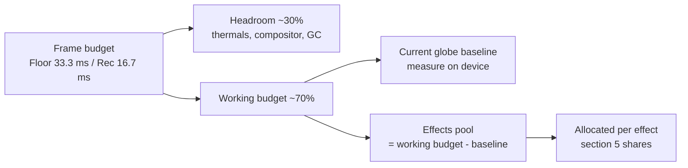
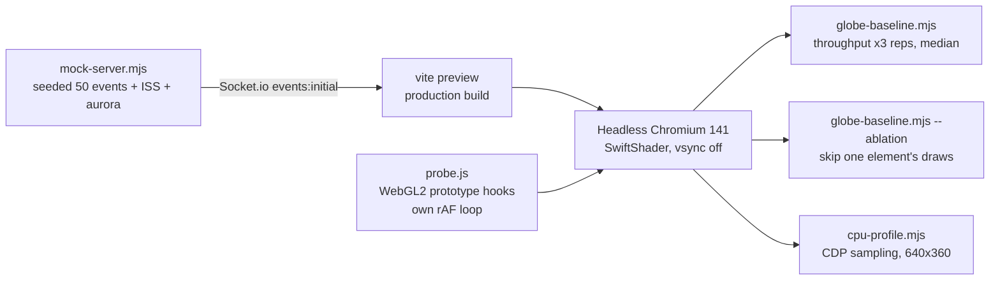
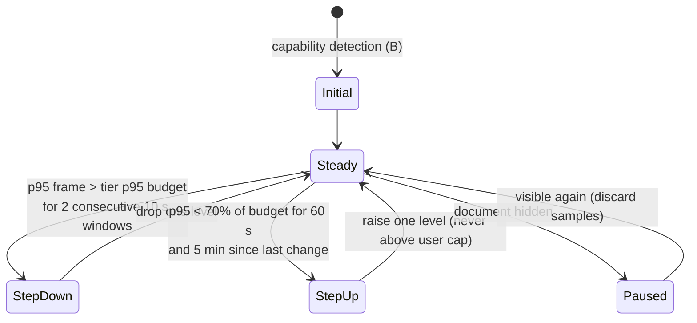

# Technical Specification: Display Targets and Frame Budget (Spike)

**Issue**: #384 (spike) | **Parent Feature**: #356 Performance and accessibility guardrails | **Epic**: #348 Living Globe
**Status**: Draft (needs owner decision on hardware tiers, see section 9)
**Author**: Architect agent | **Date**: 2026-10-18
**Location note**: this lives at `docs/specs/SPEC-384.md`, matching the existing `docs/specs/SPEC-{issue}.md` naming. There is no `docs/performance/` folder, and this spike doesn't create one.
**Tooling**: `scripts/perf/` (probe, mock backend, runners, on-device procedure in `scripts/perf/README.md`). Nothing in `src/` was changed.

> **How to read the numbers.** Every number is labelled with how it was measured. Container numbers come from headless Chromium 141 using **SwiftShader software GL** on a 4-vCPU Intel Xeon 2.1 GHz VM. That makes them good for **relative** comparisons (element A vs B, 1080p vs 4K, 0 vs 50 markers) and for **exact counts** (draw calls, triangles, texture bytes). They are **not** an estimate of fps on any real display. Hardware targets below are **assumptions** until someone runs the on-device procedure.

---

## 1. Summary

| Question                         | Answer                                                                                                                                                                                                                                                                                                                      |
| -------------------------------- | --------------------------------------------------------------------------------------------------------------------------------------------------------------------------------------------------------------------------------------------------------------------------------------------------------------------------- |
| Lowest supported display         | **Proposed:** Raspberry Pi 5 driving a 1080p TV, and iPad 9th gen (A13). Built-in smart-TV browsers are not a supported render host. Needs owner confirmation.                                                                                                                                                              |
| Frame budget                     | Floor tier: 30 fps (33.3 ms), p95 50 ms or less. Recommended and Showpiece tiers: 60 fps (16.7 ms), p95 20 ms or less.                                                                                                                                                                                                      |
| What the current globe costs     | 265 draw calls, 42.6k triangles, 58.2 MiB of textures at 50 markers (exact). The marker system is **76% of draw calls** and adds about **4 ms/frame of main-thread JS** on the container CPU. Fill cost is led by the earth sphere, then the atmosphere shells and the wireframe overlay. Device pixel ratio is not capped. |
| Effects that need a lite path    | Phosphor bloom, sweep and ping, pulse-ring expansion, and fire-marker animation and count. Terminator, callout and alert dim stay cheap if built as specified, so they need no lite variant (section 6).                                                                                                                    |
| Prerequisites before new effects | Explicit DPR cap, instanced markers and rings, a quality profile with a frame-time governor, and a draw-call/texture regression check (section 8).                                                                                                                                                                          |

---

## 2. Target hardware tiers (assumptions, owner to confirm)

None of these devices was available to the spike. Device capabilities listed come from public specs and **have not been verified here**.

| Tier                        | Reference devices (assumed)                                                                                               | Runtime                                       | Resolution and DPR cap                                                               | Default profile       |
| --------------------------- | ------------------------------------------------------------------------------------------------------------------------- | --------------------------------------------- | ------------------------------------------------------------------------------------ | --------------------- |
| **Floor** (minimum)         | Raspberry Pi 5 (4 GB or more, VideoCore VII, WebGL2 through Mesa) on a 1080p TV; iPad 9th gen (A13, 3 GB) on a wall mount | Chromium kiosk or Electron arm64; iPad Safari | 1920x1080, DPR cap **1.0** (iPad: 1.0, raise to 1.5 only if on-device test passes)   | Lite                  |
| **Recommended**             | Mini PC or laptop with Intel Iris Xe-class iGPU or Apple M1; iPad Air/Pro (M1)                                            | Electron (primary), desktop Chrome/Safari     | 1080p to 1440p, DPR cap **1.5**                                                      | Full (bloom half-res) |
| **Showpiece**               | 4K TV or monitor driven by Apple M1 Pro or newer, or a discrete GPU (GTX 1660-class or better)                            | Electron                                      | 3840x2160, DPR cap **1.0** at 4K (do not let OS scaling 2x push render size past 4K) | Full                  |
| **Unsupported render host** | Smart-TV built-in browsers (Tizen, webOS, Android TV WebView), Raspberry Pi 4 and older, iPads before A12                 | Best effort only                              | Lite forced                                                                          | Lite                  |

"Unsupported" doesn't mean blocked. It means nobody commits to a budget for those devices. A TV is still supported as a **display**, driven over HDMI by a Floor-or-better device.

---

## 3. Frame-rate and frame-time budget per tier

CPU (main thread) and GPU work overlap, so each gets its own budget. About 30% of every frame is held back as headroom for thermals (always-on, often fanless), browser compositing and GC.

| Tier        | Target fps | Frame time | p95 frame     | Max frames over 66 ms  | Main-thread JS per frame | GPU per frame | Texture memory cap | DPR cap |
| ----------- | ---------- | ---------- | ------------- | ---------------------- | ------------------------ | ------------- | ------------------ | ------- |
| Floor       | 30         | 33.3 ms    | 50 ms or less | 1% or less over 10 min | 16 ms or less            | 23 ms or less | 64 MiB             | 1.0     |
| Recommended | 60         | 16.7 ms    | 20 ms or less | 0.1% or less           | 8 ms or less             | 11 ms or less | 96 MiB             | 1.5     |
| Showpiece   | 60         | 16.7 ms    | 20 ms or less | 0.1% or less           | 8 ms or less             | 11 ms or less | 128 MiB            | 1.0 @4K |

Budget split for one frame:

**Hardware-independent ceilings.** These are exact, measurable in CI with `scripts/perf/probe.js` against the mock backend at 50 markers, and they hold on every tier:

| Metric                                          | Today (measured)             | Ceiling with all default-on effects (Full)                          | Ceiling (Lite) |
| ----------------------------------------------- | ---------------------------- | ------------------------------------------------------------------- | -------------- |
| Draw calls per frame                            | 265                          | 300 (effects add 35 or fewer in total); 120 after marker instancing | 80             |
| Triangles per frame                             | 42,552                       | 100,000                                                             | 60,000         |
| Distinct shader programs (startup compile cost) | ~9 (estimated from scene)    | 16                                                                  | 12             |
| Texture memory incl. mipmaps                    | 58.2 MiB                     | 96 MiB                                                              | 64 MiB         |
| Full-screen post-processing passes              | 0                            | 4 (bloom at half res)                                               | 0              |
| Per-frame React state updates from `useFrame`   | 1 (`CityLabelsWithTracking`) | 0 new                                                               | 0 new          |

---

## 4. Measurement method, results and limitations

### 4.1 Method

- The **probe** tags each WebGL program by its shader source (custom-shader uniforms, three.js `SHADER_TYPE` defines) and splits `MeshBasicMaterial` by geometry signature. It counts draw calls and primitives, records `texStorage2D` allocations, times rAF callbacks, and measures frame intervals. The app itself isn't instrumented.
- **Throughput** runs: 4 s warm-up, then 10 s sampled, uncapped. Each runs 3 times interleaved and the median is reported. Mean frame time is 1000 / median fps.
- **Ablation** skips one element's draw calls. That removes its raster and submission cost but not its CPU scene-graph cost.
- **CPU profile** runs at 640x360 so software fill doesn't stall the main thread, then buckets self time by bundle chunk.

### 4.2 Results: exact scene counts (hardware-independent)

| Item                         | Value                                                                                                                                             | Source               |
| ---------------------------- | ------------------------------------------------------------------------------------------------------------------------------------------------- | -------------------- |
| Draw calls/frame, 50 markers | 265 (markers ~202, labels ~60, earth 1, wireframe 1, graticule 1, atmosphere 2, stars 1, city lights 1, aurora 2, ISS 2)                          | probe per-tag count  |
| Draw calls/frame, 0 markers  | 77                                                                                                                                                | probe                |
| Triangles/frame              | 42,552 (markers ~20.2k, earth ~9.3k, atmosphere ~8.2k, aurora ~4.7k, ISS ~0.8k). Line vertices: 15,424 (wireframe sphere, graticule). Points: 858 | probe                |
| Texture memory               | 58.2 MiB: earth map 4096x2048 with 13 mip levels (~42.7 MiB), normal map 2048x1024 (~10.7 MiB), 61 label sprites 256x64 (~85 KiB each)            | probe `texStorage2D` |
| JS heap                      | 14.8 to 15.8 MiB after load                                                                                                                       | `performance.memory` |
| Bundle                       | vendor-three 1,168.6 kB (324.3 kB gzip), main 601.4 kB (136.1 kB gzip), CSS 44.8 kB (9.3 kB gzip)                                                 | `vite build` output  |

### 4.3 Results: relative costs (SwiftShader, container; do not read as device fps)

Throughput, 1080p, median of 3:

| Scenario                         | fps (range)      | Mean frame ms | vs baseline   |
| -------------------------------- | ---------------- | ------------- | ------------- |
| Clear only (all draws skipped)   | 49.2 (46.7–49.4) | 20            | floor of page |
| Empty globe (0 markers)          | 8.4 (4.4–8.5)    | 119           | noisy         |
| **Baseline (50 markers), DPR 1** | 3.3 (3.2–3.5)    | 303           | 1.0x          |
| Baseline, DPR 2                  | 1.5 (1.4–1.6)    | 667           | 2.2x slower   |
| Baseline, 4K DPR 1               | 1.4 (1.4–1.6)    | 714           | 2.4x slower   |
| Baseline, reduced motion         | 4.0 (3.9–5.4)    | 250           | within noise  |

Ablation, 1080p, DPR 1, 50 markers, median of 3:

| Element skipped                                    | Frame ms | Saved vs 303 ms | Share |
| -------------------------------------------------- | -------- | --------------- | ----- |
| Earth sphere (`MeshStandardMaterial` + normal map) | 208      | 95              | ~31%  |
| Atmosphere (2 additive back-face shells)           | 250      | 53              | ~17%  |
| Wireframe overlay sphere                           | 250      | 53              | ~17%  |
| Markers (sphere + ring + pulse ring per event)     | 263      | 40              | ~13%  |
| City labels (61 sprites)                           | 286      | 17              | ~6%   |
| Stars                                              | 313      | 0 (noise)       | ~0%   |

Main-thread CPU (CDP sampling profile, 640x360, 10 s):

| Metric                                   | 0 markers | 50 markers |
| ---------------------------------------- | --------- | ---------- |
| rAF callback mean / p95 (ms)             | 1.7 / 3.5 | 5.8 / 10.8 |
| Non-idle main-thread ms per frame        | ~3.0      | ~8.3       |
| three.js + r3f chunk self time per frame | 1.0       | 3.5        |
| React + app chunk self time per frame    | 0.02      | 0.09       |

Startup (CDP profile from navigation to first draw):

| Metric                     | Value                                                                                                                                                                                      |
| -------------------------- | ------------------------------------------------------------------------------------------------------------------------------------------------------------------------------------------ |
| First WebGL draw after nav | 6.5 to 7.0 s                                                                                                                                                                               |
| Long tasks                 | ~1.4 to 1.6 s, then ~5.8 to 6.1 s                                                                                                                                                          |
| Attribution                | ~6.1 s in three.js program link-status check, a synchronous wait on shader compile. Its size is specific to SwiftShader. Another ~1.1 s goes to `generateHeightCanvas` (app JS, CPU-bound) |

### 4.4 Findings for the existing scene

1. **The marker system drives draw calls and main-thread cost.** Every event is three meshes, each with its own `useFrame`. At 50 markers that is about 202 of 265 draw calls and about +4 ms/frame of main-thread JS on a server-class core. Planned pulse rings and fire markers would make this worse unless they are instanced.
2. **DPR is uncapped.** r3f's default `dpr` is `[1, 2]`. An iPad or a 2x-scaled 4K desktop renders 4x the pixels. DPR 2 was 2.2x slower here, which matters most for fill-bound effects such as bloom and sweep.
3. **Fill cost sits in a few full-globe layers.** Earth, two atmosphere shells and the wireframe overlay. These are the natural lite levers for existing content. The wireframe's 17% share may be exaggerated by SwiftShader line rasterisation, so check it on a device.
4. **Reduced motion doesn't reduce work.** It zeroes shader amplitudes, but the scene still renders every frame and auto-rotation continues.
5. **Labels draw even when hidden.** 61 sprites each have their own texture and draw call. Hidden tiers use opacity 0, so they are still submitted.
6. **Startup grows with shader count.** Every new effect program adds compile time to first frame. On Pi-class GPUs this is unknown and needs on-device measurement.
7. **Minor:** `CityLabelsWithTracking` calls `setState` from `useFrame` every frame. React bails out when the distance is unchanged, so the cost appears only while zooming. Don't copy this pattern in new effects.

### 4.5 Limitations (what was not measured)

- **No real GPU, Pi, iPad, TV browser or Electron build was measured.** Every absolute fps number above is software rendering. None of the tier fps targets has been validated.
- **No GPU timer data.** `EXT_disjoint_timer_query_webgl2` isn't available under SwiftShader. The probe's `gl.finish()` attribution mode turned out to measure submission overhead, not raster: the earth draw read 0.03 ms. Its numbers are excluded here and the caveat is documented in `probe.js`.
- **Non-additive and noisy.** The empty-scene run varied 2x between reps. Ablation savings sum to about 84% of frame time. Treat shares as rank order, not precise fractions.
- **Not measured:** power draw, thermals over hours, memory growth over 24 h, Safari/WebKit behaviour, and the DOM/CSS cost of side columns and ticker on low-end CPUs. On SwiftShader the clear-only floor of 20 ms suggests it is small but not zero.
- **The CPU number is for the container CPU.** A Pi 5 core is expected to be several times slower. That is an assumption, so measure it.

---

## 5. Per-effect cost allocation (planned Living Globe effects)

The shares divide the **effects pool** from section 3. The pool is the working budget minus the on-device baseline. Draw-call and texture limits are hard ceilings and don't depend on hardware.

| Effect (feature)                                           | Main cost driver                                    | Hard limits (Full)                                                                                                                                | Pool share | Floor / Lite behaviour                                                                   | Needs lite?            |
| ---------------------------------------------------------- | --------------------------------------------------- | ------------------------------------------------------------------------------------------------------------------------------------------------- | ---------- | ---------------------------------------------------------------------------------------- | ---------------------- |
| Solar terminator + shader city lights (#357)               | Fragment math on earth; optional night texture      | +0 draw calls (extend existing materials); sun direction updated at 1 Hz or slower, not per frame; night texture 4096x2048 or smaller (+42.7 MiB) | 10%        | Same shader; night texture 2048x1024 or smaller (+10.7 MiB) or existing city points only | No (texture size only) |
| Magnitude pulse rings (#359)                               | Draw calls, overdraw of expanding transparent rings | 2 draw calls or fewer total (instanced); 8 or fewer concurrent animated rings; 0.3 ms or less JS per frame                                        | 10%        | 3 or fewer concurrent; static ring (no expansion) when degraded or reduced motion        | **Yes**                |
| Tactical callout (#358)                                    | Per-frame screen-space projection and DOM layout    | 1 callout; 1 draw call or fewer for leader line; position updated by ref/transform with no React state per frame; 0.5 ms or less                  | 5%         | Position update at 10 Hz or slower                                                       | No                     |
| Sweep and ping (#360)                                      | Fill: one additive shell or disc over the globe     | 2 draw calls or fewer; ping driven by a uniform on instanced markers, never per-marker meshes                                                     | 15%        | **Off** at Floor; first to auto-disable after bloom                                      | **Yes**                |
| Phosphor overlay: scanlines, bloom, vignette, drift (#362) | Bloom: offscreen render target + blur passes        | Scanlines, vignette and drift as static CSS layers (0 WebGL draws); bloom at half res, 4 passes or fewer                                          | 35%        | CSS scanlines, vignette and drift only; **no bloom**                                     | **Yes**                |
| Fire markers with clustering (#367, FIRMS)                 | Instance count, clustering CPU                      | 1 draw call for all fires; 1,000 or fewer cluster instances; clustering only on data arrival (server-side or worker), never per frame             | 15%        | 250 or fewer instances; no per-fire animation                                            | **Yes**                |
| Alert dim and recenter (#361)                              | CSS opacity transition; existing rotation lerp      | 0 extra draw calls; no material `defines` toggles (avoid shader recompiles mid-alert)                                                             | 5%         | Same; reduced motion: cut instead of animated recenter                                   | No                     |
| Reserve                                                    |                                                     |                                                                                                                                                   | 5%         |                                                                                          |                        |

---

## 6. Lite fallback and auto-degrade

### 6.1 Options considered

| Option                                                                                                                       | Pros                                                      | Cons                                                                                                |
| ---------------------------------------------------------------------------------------------------------------------------- | --------------------------------------------------------- | --------------------------------------------------------------------------------------------------- |
| A. Manual profile only (Full or Lite in settings)                                                                            | Simple, predictable, no runtime logic                     | Wrong default on unknown hardware; owner must notice the stutter first                              |
| B. Capability detection at startup (renderer string, `hardwareConcurrency`, `deviceMemory`, screen size, `MAX_TEXTURE_SIZE`) | Sensible first frame; no flicker                          | Heuristics go stale; can't see thermals or other tabs; renderer strings are masked on some browsers |
| C. Runtime frame-time governor with hysteresis                                                                               | Responds to real conditions, including thermal throttling | Needs tuning; risks visible quality oscillation if hysteresis is wrong                              |

**Decision (proposed): B picks the initial profile, C adjusts at runtime, and A is an override.** The settings choice is Auto, Full or Lite, and Auto is the default. A manual choice caps the governor: it never steps above what the user picked. This is the only approach that covers both "unknown device on first boot" and "fanless Pi throttling after 3 hours".

### 6.2 Degrade ladder (governor steps down in this order, back up in reverse)

| Level | Change                                                                                       | Reason for position                                      |
| ----- | -------------------------------------------------------------------------------------------- | -------------------------------------------------------- |
| L0    | Full                                                                                         |                                                          |
| L1    | Bloom off (phosphor drops to CSS only)                                                       | Biggest planned fill cost, purely decorative             |
| L2    | Sweep and ping off                                                                           | Opt-in decoration, full-globe fill                       |
| L3    | Pulse rings static, 3 or fewer concurrent; fire markers no animation, 250 or fewer instances | Keeps information, drops motion                          |
| L4    | DPR cap 1.0                                                                                  | Largest single fill lever (2.2x measured)                |
| L5    | 30 fps frame cap; outer atmosphere shell and wireframe overlay off                           | Existing fill-heavy decoration (about 17% each measured) |
| Never | Event markers, severity colours and labels, alert behaviour, terminator                      | Core information; colour-independence rules from #385    |

---

## 7. On-device measurement procedure

The full checklist is in `scripts/perf/README.md`. In short:

1. Run the production build on the device at its deployment resolution and scaling, and let it warm up for 2 minutes.
2. Paste `scripts/perf/probe.js` into DevTools (Electron devtools, `chrome://inspect` for Pi Chromium, or Safari Web Inspector for iPad), then sample for 60 s.
3. Repeat with `setSkip(['markers'])`, and with reduced motion on.
4. Record the results below, plus temperature after 10 minutes (`vcgencmd measure_temp` on Pi).

### 7.1 On-device results (to be filled in by the owner)

| Device | Browser/runtime | Resolution / DPR | WebGL renderer | Median fps | p95 frame ms | Frames over 33 ms | rAF cb p95 | Temp @10 min | Notes |
| ------ | --------------- | ---------------- | -------------- | ---------- | ------------ | ----------------- | ---------- | ------------ | ----- |
|        |                 |                  |                |            |              |                   |            |              |       |

---

## 8. Acceptance criteria for follow-up stories (children of #356)

Each one is testable with the tooling in `scripts/perf/` or with unit tests.

1. **DPR cap.** With the profile set to Floor, the canvas backing-store width divided by its CSS width is 1.0 or less on a DPR 2 viewport. With Recommended, it is 1.5 or less. Verified with Playwright `deviceScaleFactor: 2`.
2. **Draw-call ceiling.** Mock backend, 50 markers, all default-on effects enabled: probe-reported draw calls per frame are 300 or fewer. After the marker-instancing story, 120 or fewer. Lite is 80 or fewer. Any new effect PR includes the before and after probe counts.
3. **Instanced markers.** With 50 markers, the marker system (spheres, rings, pulse rings) issues 6 or fewer draw calls per frame. Visual output and click selection are unchanged; existing marker tests pass.
4. **Effect registry contract.** Every effect registered with the Mode Deck (#351) declares a cost class, its Lite behaviour and its ladder level. A unit test fails if any effect lacks them.
5. **Governor.** Unit test with injected frame intervals and a fake clock: p95 above budget for two consecutive 10 s windows steps down exactly one level within 21 s. It doesn't step up until 60 s under 70% of budget, and never steps above the user-selected profile.
6. **Lite excludes decoration.** In Lite, the probe shows no draw calls tagged bloom or sweep, and texture memory is 64 MiB or less.
7. **No new per-frame React state.** New effect components contain no `setState` or store `set` inside `useFrame`. Enforced in review checklist and spot-checked by the CPU profile: the React + app chunk stays at 0.5 ms/frame or less at 640x360 with 50 markers.
8. **On-device sign-off.** Before #360 (sweep) or #362 (phosphor) merge, section 7.1 has at least one Floor and one Recommended device row meeting the section 3 p95 budget with the default profile.

---

## 9. Open questions for the owner

1. **Which Floor device do you actually deploy?** Pi 5, Pi 4, iPad 9th gen, or something else? This decides whether Floor is 30 fps or Lite-only.
2. **Are built-in smart-TV browsers out of scope as render hosts?** Proposed: yes.
3. **Is 30 fps acceptable at Floor** for an ambient display? Rotation is 0.06 rad/s, so 30 fps is visually smooth, and it lowers power and heat.
4. **Should reduced motion also stop auto-rotation** and allow on-demand rendering (near-zero idle GPU)? `PRODUCT.md` only lists sweep and glow.
5. **Lite earth material.** Is a visibly simpler earth (no normal map, cheaper shading) acceptable at L5? It is the largest measured fill cost.
6. **Night-lights texture source and size for #357.** This affects memory (+10.7 to +42.7 MiB) and licensing.
7. **Should the performance profile (Auto, Full, Lite) appear in the settings panel?** That needs UX (#226 pattern).
8. **Is a perf regression check in CI wanted?** It would touch `.github/workflows/**`, which is high-risk surface needing architect review. Proposed: start as a non-gating job that posts probe counts.

---

## 10. Risks

| Risk                                                          | Impact | Likelihood | Mitigation                                                                       |
| ------------------------------------------------------------- | ------ | ---------- | -------------------------------------------------------------------------------- |
| Tier targets are wrong because nothing was measured on device | High   | Medium     | AC 8 blocks the costly effects until section 7.1 has real rows                   |
| Pi 5 can't hold 30 fps even for the current globe at 1080p    | High   | Unknown    | Measure first; if it fails, Floor becomes Lite plus 30 fps cap, or move Floor up |
| Governor oscillation is visible on the display                | Medium | Medium     | Hysteresis (70%, 60 s, 5 min), one step at a time                                |
| Shader count growth slows cold start on Pi                    | Medium | Medium     | Programs ceiling (16); async compile where three.js supports it                  |
| SwiftShader shares mislead prioritisation                     | Medium | Medium     | Use them for rank order only; re-run ablation on a real GPU                      |
